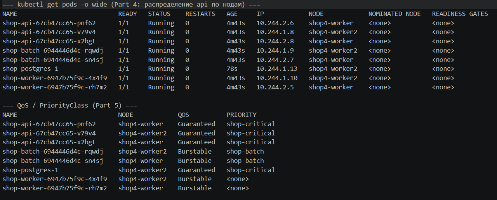
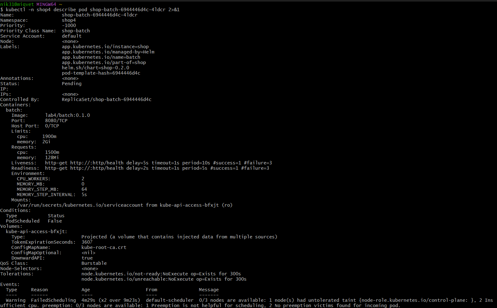
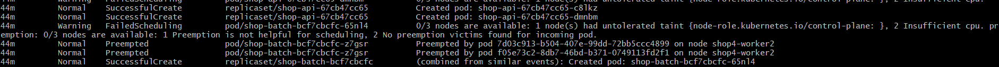
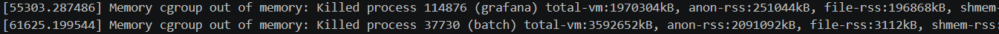
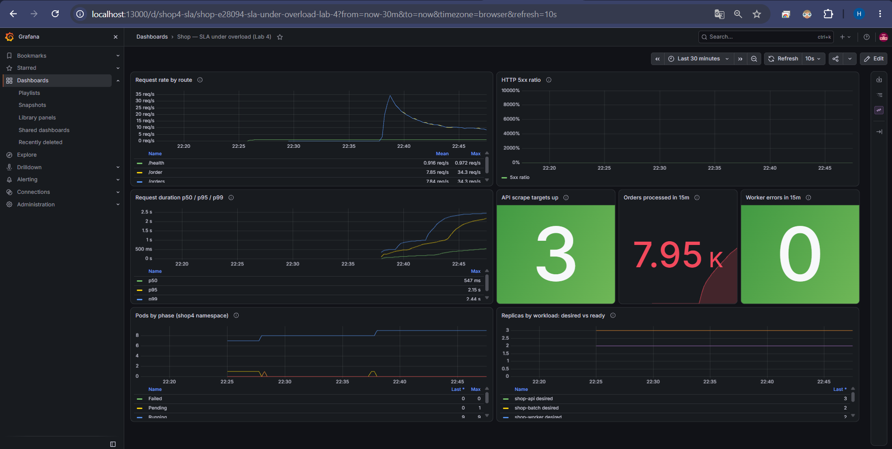
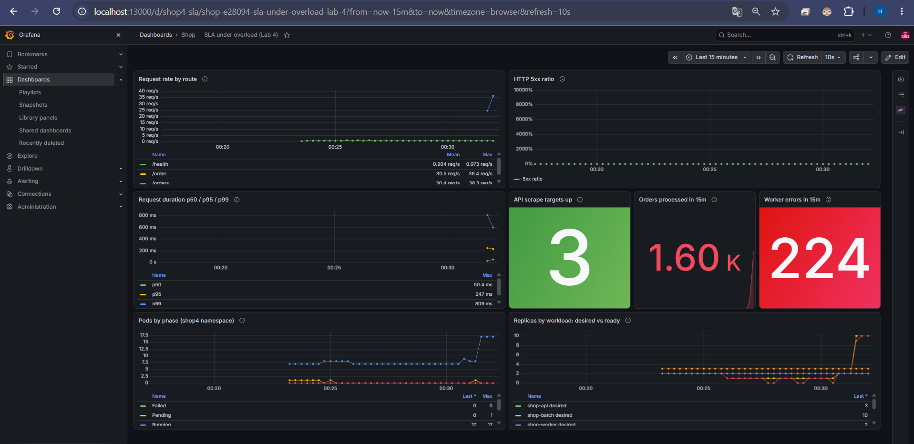
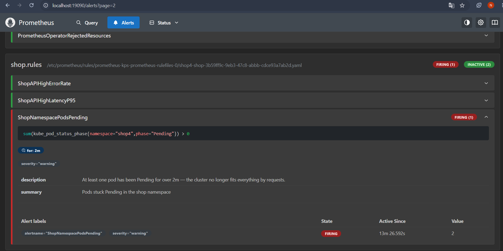
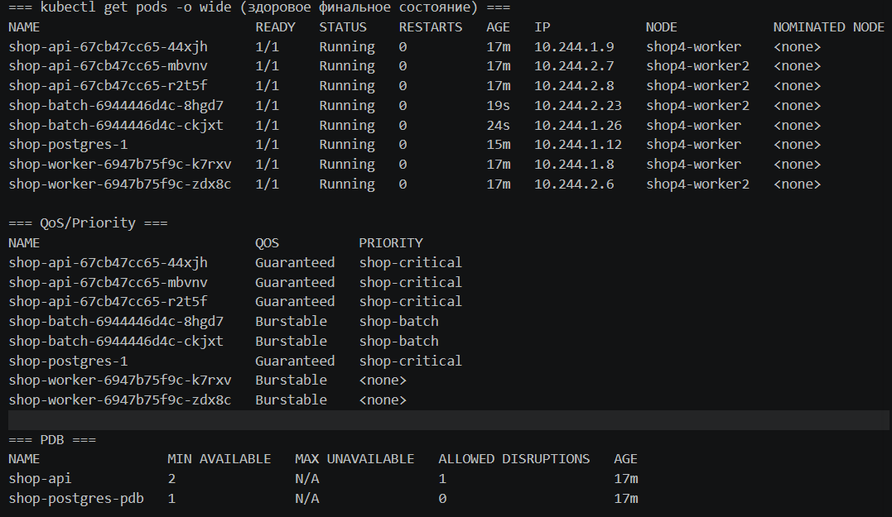

# Лаба 4 — SLA критического пути под перегрузкой

## Стенд

| Компонент | Конфигурация |
| --- | --- |
| Хост | Windows 11, Docker Desktop 27.2.0 (backend WSL2), 12 логических CPU, 25 ГБ RAM |
| Кластер | kind v0.33.0, Kubernetes 1.33.1, 1 control-plane + 2 worker-ноды |
| Ограничение нод | `docker update --cpus=2 --memory=3g` на каждый worker, `--cpus=1 --memory=1.5g` на control-plane — кластер тесный умышленно (см. Часть 2) |
| Helm | 4.3.0 |
| Сервисы | Go 1.22, `net/http`, pgx 5.7.2 (api/worker — перенесены из лабы 3 без изменений) |
| PostgreSQL | CloudNativePG 1.30.1 (chart 0.29.1), 1 инстанс |
| Мониторинг | kube-prometheus-stack 90.1.1 (тот же стек, что в лабе 2) |

Чарт `shop` — тот же, что в лабе 3, расширенный под эту лабу (не копия, продолжение).
Полная история экспериментов с метками времени и что из этого реально подтверждено живым
прогоном — в [`VERIFICATION.md`](VERIFICATION.md). Здесь — только итог и объяснения.

## Part 0 — сервис batch

`cmd/batch/main.go` — симулятор «ночной аналитики»: N горутин в busy-loop жрут CPU
(`CPU_WORKERS`), плюс отдельная горутина растит и держит реальный `[]byte` в памяти
(`MEMORY_MB`, шагами `MEMORY_STEP_MB` каждые `MEMORY_STEP_INTERVAL`) — специально шагами, а не
залпом, чтобы можно было поднимать давление на узел постепенно и наблюдать момент отказа, а не
сразу получить OOM на старте. `/health` всегда `ok` — задача batch не падать от собственного
кода, а быть принесённым в жертву планировщиком/kubelet'ом снаружи.

## Part 1 — выбор механизма распределения

Выбран `topologySpreadConstraints`, не `podAntiAffinity`:

- `podAntiAffinity` (`requiredDuringScheduling`) — жёсткое «никогда на одной ноде», по сути
  бинарное правило. На кластере с небольшим числом нод это неизбежно упирается в ту же
  проблему, что ловим в Part 6: как только реплик становится больше, чем нод, под с
  anti-affinity просто не сможет запланироваться вообще — упадёт в `Pending` без возможности
  частичного компромисса.
- `topologySpreadConstraints` с `maxSkew: 1` — мягче и точнее: не «никогда вместе», а «разница
  между самой и наименее заполненной нодой не больше `maxSkew`». Для 3 реплик `api` на 2 нодах
  это даёт `[2,1]` (это именно то, что и наблюдаем в Part 4) — более полное использование
  кластера, при этом та же цель отказоустойчивости (не все реплики на одной ноде) соблюдена.
- `topologySpreadConstraints` даёт честный контроль над тем, какой узел считается доменом
  распределения, через `nodeTaintsPolicy` — что оказалось критично на практике, см. ниже.

Настоящий баг, пойманный при первом же деплое: `topologySpreadConstraints` по умолчанию считает
доменом распределения **любую** ноду с подходящей меткой `topologyKey`, включая
`control-plane` — даже ту, куда ни один под `api` не может попасть из-за taint'а. При 2 running
+ 1 ожидающий под получаем домены `[control-plane: 0, worker: 1, worker2: 1]`; попытка
разместить 3-й под на любой worker даёт `[0, 2, 1]` — skew = 2 > `maxSkew: 1` → `Pending`, хотя
по смыслу 2-1 на двух реальных нодах — это ровно то, что мы хотим. Фикс — явный
`nodeTaintsPolicy: Honor` в `topologySpreadConstraints` ([`api-deployment.yaml`](charts/shop/templates/api-deployment.yaml)):
он говорит планировщику не считать домен, на который подов `api` и так не допустит taint.
После фикса — чистое `[1,1]` → `[2,1]`.

Переключатель живёт в `values.yaml` (`spreading.mechanism: topologySpreadConstraints |
podAntiAffinity`), шаблон реализует оба варианта.

## Part 2 — тесный кластер

`kind` с 1 control-plane + 2 worker ([`deploy/kind-cluster.yaml`](deploy/kind-cluster.yaml)).
Явно ограничил сами контейнеры нод через `docker update`, чтобы кластер был тесным не только
на бумаге, но и по-настоящему:

```powershell
docker update --memory=3g --memory-swap=3g --cpus=2 shop4-worker
docker update --memory=3g --memory-swap=3g --cpus=2 shop4-worker2
docker update --memory=1.5g --memory-swap=1.5g --cpus=1 shop4-control-plane
```

Важная и неочевидная находка: `kubectl describe node` после этого продолжает показывать
**старую, полную ёмкость хоста** — `cpu: 12`, `memory: 11922620Ki` на каждой ноде, то есть
Allocatable для планировщика не меняется. Причина: кубелетовское определение machine info
читает host-level `/proc/meminfo`/`nproc`, которые cgroup-лимит контейнера не переписывает —
под cgroup v1 это разные источники данных. Но **реальный** cgroup-лимит контейнера (тот, что
видит `docker stats`, и тот, в который реально упирается ядерный OOM-killer) — настоящий. Это
ровно два разных механизма:

- планировщик при решении о **размещении** смотрит на Allocatable (фиктивно большой) и на
  сумму `requests` (наши собственные числа) — вот почему Part 6 ловит `Pending` при разумном
  числе реплик, а не при пятидесяти;
- ядро при решении о **памяти** смотрит на настоящий cgroup-лимит ноды-контейнера — вот почему
  Part 7 реально ловит OOM, а не просто бесконечно растущий, но безопасный расход.

Добавил `batch` как шаблон чарта ([`batch-deployment.yaml`](charts/shop/templates/batch-deployment.yaml)),
с собственными `resources.requests/limits` — guardrail из лабы 3 ("у каждого пода есть лимиты")
применён без исключений.

Другой пойманный баг на этом шаге: `batch.resources.limits.cpu: "4"` не запустился —
`OCI runtime create failed ... failed to write "400000" to cpu.cfs_quota_us: invalid argument`.
Причина прямая: родительский cgroup (сам контейнер ноды, ограниченный `docker update --cpus=2`)
не может выдать дочернему cgroup квоту больше своей собственной (`200000` на период `100000` =
2 ядра). Исправлено — `limits.cpu` снижен до `"1900m"`, безопасно ниже реального потолка ноды.

## Part 3 — настоящие числа вместо догадки

Прогнал `k6` против `/order`, затем `krr` (`robustadev/krr:v1.30.0`, через Docker — pip-пакета
`krr`/`robusta-krr` в PyPI не существует, инструмент распространяется только как
git+requirements.txt или Docker-образ). Полный вывод и методология — в
[`evidence/part3-load-and-usage.txt`](evidence/part3-load-and-usage.txt) и
[`krr/krr-report.json`](krr/krr-report.json). Здесь — суть.

### Находка №1 (методологическая): `kubectl port-forward` не балансирует нагрузку

Первый прогон `k6` через `kubectl port-forward svc/shop-api` дал `p95=1.28s` при лимите api в
`250m` CPU — выглядело как «api слишком слаб». Проверка через Prometheus показала: `port-forward`
на `Service` фиксируется на **одном** выбранном поде на всё время соединения — весь трафик шёл
на одну реплику (`0.2486` ядра, упор в лимит), а две другие стояли простаивающими (`0.001`
ядра). Это не недостаток api — это недостаток метода нагрузки. Переключился на `k6` как
Kubernetes `Job` внутри кластера, бьющий по `ClusterIP` через DNS-имя — так трафик реально идёт
через `Service → EndpointSlice → kube-proxy`, и балансировка настоящая.

### Находка №2: даже с честной балансировкой `api` реально не укладывался в 250m

Повторный прогон с честной балансировкой — все три реплики `api` одинаково вышли на `~249-250m`
CPU (упор в старый лимит `250m`), `p95=1.07s`. Это уже настоящий, не искусственный разрыв между
догадкой лабы 3 (`100m`/`250m`) и спросом под нагрузкой.

### Находка №3: `krr` не видит Pod, которым владеет CloudNativePG

`krr` анализирует только `Deployment`/`StatefulSet`/`DaemonSet`/`Job` — он прошёлся по `api` и
`worker`, но для `postgres` в отчёте нет записи вообще: Pod `postgres-1` создан напрямую
контроллером `Cluster` (CRD CloudNativePG), это не один из типов, которые `krr` умеет
обнаруживать. Для `postgres` посчитал то же самое вручную — той же формулой, что использует
`krr` (p95 для CPU, max+15% для памяти) — через PromQL напрямую по `container_cpu_usage_seconds_total`/`container_memory_working_set_bytes`.

### Итоговое сравнение: догадка (лаба 3) → факт

| | было (догадка лабы 3) | факт под нагрузкой | стало (values.yaml) |
| --- | --- | --- | --- |
| `api` cpu | `100m`/`250m` (req/lim) | p95 ≈ `249m`, **уже упёрт в лимит** (реальный спрос ≥ этого) | `400m`/`400m` (с запасом сверху замера) |
| `api` memory | `64Mi`/`128Mi` | max ≈ `68MB` | `100Mi`/`100Mi` |
| `postgres` cpu | `100m`/`500m` | p95 ≈ `266m` (без упора в лимит — настоящий спрос) | `300m`/`300m` |
| `postgres` memory | `256Mi`/`512Mi` | max ≈ `102MB` | `140Mi`/`140Mi` |
| `worker` cpu | `25m`/`100m` | p95 ≈ `6-15m` | `25m`/`100m` (не менял — догадка и так точная) |
| `worker` memory | `32Mi`/`64Mi` | max ≈ `20-25MB` | `48Mi`/`96Mi` (небольшой запас) |

Вывод: догадка для `api` была не просто «неточной» — она активно мешала (подробнее в Part 8:
заниженный `requests` у критического пути даёт ему меньший вес в `cpu.shares`, чем у `batch`).
Догадка для `worker` оказалась почти идеальной — не каждая прикидка одинаково плоха, это тоже
честный результат проверки, а не повод всё переписывать без замера.

## Part 4 — распределение критического пути

```
NAME                        NODE            IP
shop-api-67cb47cc65-bgkvj   shop4-worker2   10.244.2.8
shop-api-67cb47cc65-nhm6c   shop4-worker2   10.244.2.9
shop-api-67cb47cc65-r8w6j   shop4-worker    10.244.1.7
```

([`evidence/part4-api-spread.txt`](evidence/part4-api-spread.txt)) — `[2,1]`, `maxSkew: 1`
соблюдён, обе реальные рабочие ноды заняты. Если одна нода падает — максимум 2 из 3 реплик
теряются одновременно, а не все 3; при 2 нодах это лучшее, что можно гарантировать без
третьей ноды.



## Part 5 — приоритеты, QoS, PodDisruptionBudget

- `PriorityClass shop-critical` (`value: 1000000`) — на `api` и `postgres`.
- `PriorityClass shop-batch` (`value: -1000`, **ниже** дефолтного приоритета `0`) — на `batch`,
  так что даже обычные поды без явного класса при конкуренции важнее batch.
- `api`/`postgres`: `requests == limits` (числа из Part 3) → `Guaranteed` QoS.
- `batch`: `requests` (`1500m`/`128Mi`) заметно ниже `limits` (`1900m`/`2Gi`) → `Burstable`. CPU
  `requests` у batch специально большой относительно 12-ядерного (фиктивного) Allocatable — это
  осознанная настройка just for Part 6, см. комментарий в `values.yaml`.
- `PodDisruptionBudget` на `api` (`minAvailable: 2` из 3) и на `postgres` (`minAvailable: 1` из 1).

Настоящий баг, пойманный здесь: шаблон `postgres`-PDB изначально назывался
`{{ fullname }}-postgres` — то есть **тем же именем**, которым CloudNativePG называет свой
собственный авто-управляемый PDB (имя буквально равно имени `Cluster`). Пока `enablePDB` не
выставлен в `false`, оператор считает любой PDB с этим именем "своим" и на каждом цикле
reconcile подчищает/пересоздаёт его — наш PDB то появлялся, то пропадал без видимой причины.
Исправлено двумя вещами: `enablePDB: false` в `Cluster.spec` + собственный PDB переименован в
`<fullname>-postgres-pdb`, чтобы имена не совпадали вообще. QoS/`PriorityClass` у всех подов —
на том же скриншоте выше (нижняя таблица).

Burstable vs Guaranteed под давлением — что это на самом деле даёт (не теория, а то, что
реально наблюдал в Part 6/7):

- **При нехватке CPU/памяти для размещения** — планировщик рассматривает `batch` как жертву
  `preemption`, потому что его `PriorityClass` ниже; `api`/`postgres` для вытеснения не
  рассматриваются вообще (их приоритет выше любого реально работающего пода в namespace).
- **При настоящем cgroup OOM на ноде** — `kubelet` ставит каждому контейнеру `oom_score_adj` по
  QoS: `Guaranteed` → `-997` (практически неприкасаемый), `Burstable` → пропорционально
  соотношению `requests`/`limits` (ближе к `BestEffort`, у нашего batch вышло `990` — см.
  [`evidence/part7-dmesg-oom-kernel-evidence.txt`](evidence/part7-dmesg-oom-kernel-evidence.txt)).
  Ядерный OOM-killer убивает процесс с наибольшим `oom_score_adj` — то есть `batch`, даже если
  формально решение принимает не Kubernetes, а голое ядро Linux.
- Что это **не** даёт: `PriorityClass` не влияет на `cpu.shares` (реальный вес в CFS-планировщике
  ядра при дележе процессорного времени) — это отдельная ось, управляемая только `requests`.
  Отдельная, настоящая находка про это — в Part 8.

## Part 6 — дефицит и preemption

Поднял `batch.replicaCount` с 2 до 18 (`helm upgrade --set batch.replicaCount=18`). Полные логи
событий — [`evidence/part6-events.txt`](evidence/part6-events.txt).

**`Pending` — именно по причине, которую объясняет лекция ("планировщик считает резерв, а не
факт"):**

```
0/3 nodes are available: 1 node(s) had untolerated taint {node-role.kubernetes.io/control-plane: },
2 Insufficient cpu. preemption: 0/3 nodes are available: 1 Preemption is not helpful for
scheduling, 2 No preemption victims found for incoming pod.
```

На этом этапе вытеснения не было — `Pending` ловили сами поды `batch` (у вытеснения нет смысла:
кого вытеснять в пользу другого batch того же приоритета).



**Настоящий `preemption`, когда дефицит мешает критическому пути.** Подрастил `api.replicaCount`
с 3 до 5 ровно в тот момент, когда `batch` занял почти всю ёмкость обеих нод:

```
Normal   Preempted         pod/shop-batch-6944446d4c-lj7rc   Preempted by pod 8e242454-c7b5-459e-a37f-c7d5183b7ad9 on node shop4-worker
Normal   ScalingReplicaSet deployment/shop-api               Scaled up replica set shop-api-67cb47cc65 from 3 to 5
```

Новый под `api` получил `nominatedNodeName: shop4-worker` ещё до того, как жертва полностью
завершилась — это видимое доказательство, что решение о preemption приняло планирование, а не
случайное освобождение места. Полная цепочка — [`evidence/part6-pods-after-preemption.txt`](evidence/part6-pods-after-preemption.txt),
[`evidence/part6-preempting-api-pod-describe.txt`](evidence/part6-preempting-api-pod-describe.txt).



Повторил это уже под камерой, отдельно для скриншотов (другой прогон, та же механика): `batch`
снова поднят до дефицита, затем `api.replicaCount` 5→7 — и снова `Preempted`, на другом поде и
с другим UID вытесняющего пода, что само по себе подтверждает: это не единичная случайность, а
воспроизводимое поведение планировщика.

## Part 7 — давление по памяти, эвикшн

Поднимал `batch.memoryMB` шагами (`cpuWorkers=0`, чтобы не путать переменные с CPU) —
[`evidence/part7-memory-trace.txt`](evidence/part7-memory-trace.txt),
[`part7-memory-trace2.txt`](evidence/part7-memory-trace2.txt),
[`part7-memory-trace3.txt`](evidence/part7-memory-trace3.txt). Коротко по числам:

| `memoryMB` (на под) | реальная память ноды | итог |
| --- | --- | --- |
| 1600 | плато на **88%** от 3 ГБ реального лимита ноды, стабильно, без единого сбоя | ничего не происходит — под лимитом |
| 2000 | плато на **95%**, стабильно минуту+ | то же — под лимитом, просто ближе |
| 2300 | ушло выше — настоящий убитый процесс | **есть событие** |

**Настоящая находка, расходящаяся с «учебником»:** событие killed оказалось не тем, что
ожидалось. `kubectl describe` показал `Reason: Error`, не `OOMKilled`, exit code `137` — в этом
окружении (kind + Docker Desktop + cgroup v1) `kubelet` не всегда надёжно подписывает причину
убийства строкой `OOMKilled`, даже когда это она. Подтверждение взял на уровень ниже —
`dmesg` на самой ноде ([`evidence/part7-dmesg-oom-kernel-evidence.txt`](evidence/part7-dmesg-oom-kernel-evidence.txt)):

```
Memory cgroup out of memory: Killed process 67103 (batch) ... anon-rss:2091504kB ... oom_score_adj:990
oom-kill:constraint=CONSTRAINT_MEMCG, ... task_memcg=/.../kubepods-burstable-pod.../cri-containerd-<id>.scope
```

`constraint=CONSTRAINT_MEMCG` плюс путь cgroup, заканчивающийся на **собственный** scope
контейнера (не на корневой cgroup ноды), означает: это убийство за превышение **собственного**
лимита пода (`resources.limits.memory: 2Gi`, `anon-rss` ≈ `2044MiB` — ровно на границе), не
эвикшн по давлению на весь узел. Поставил контрольный эксперимент, чтобы отделить одно от
другого максимально чисто: один-единственный `batch` на ноде, где больше ничего не борется за
память, с целью (`2500MB`) заведомо выше его же лимита (`2Gi`) — получил то же самое: убит за
свой собственный лимит, подтверждено тем же способом через `dmesg`
([`evidence/part7-selflimit-trace.txt`](evidence/part7-selflimit-trace.txt)).



Чем это отличается от честного эвикшна по давлению на ноду (то, что по тексту лекции должен
делать `kubelet`'овский eviction manager, выбирая жертву по QoS среди **всех** подов ноды, а не
только внутри собственного cgroup одного пода): сигнал `memory.available`, на который смотрит
eviction manager, в этой конкретной среде считается от **фиктивного** Allocatable узла (то же
искажение, что в Part 2 — host-level число, не настоящий cgroup-лимит), поэтому мягкий,
управляемый kubelet'ом эвикшн здесь практически никогда не наступает раньше, чем жёсткий
ядерный OOM на границе cgroup конкретного пода. В реальном облачном кластере (без искажения
Allocatable) это разделение сработало бы по учебнику. `oom_score_adj: 990` (видно в dmesg) — это
именно тот механизм, который гарантирует, что при настоящем общем дефиците памяти на ноде
первым убит окажется `batch` (`990`, почти как `BestEffort`), а не `Guaranteed` `api`/`postgres`
(`-997`) — так что защита по QoS реально работает, просто через другой, более прямой путь
(`oom_score_adj` у голого ядра), чем через kubelet'овский eviction manager.

## Part 8 — SLA под нагрузкой

Заявленный SLA: p95 < 300 мс на `/order`, 0% ошибок — даже когда деградирует `batch`.
Полные числа — [`evidence/part8-sla-under-load.txt`](evidence/part8-sla-under-load.txt).



При `batch.replicaCount=16` с его стандартным `cpuWorkers=2` (реально жрёт CPU до своего
лимита) и уже возникшим дефицитом (2 pending batch) прогнал `k6` (15 VUs, 4 мин, `Job` внутри
кластера):

```
checks_succeeded: 100.00%  http_req_failed: 0.00%  (1744/1744 запросов, ни одной ошибки)
http_req_duration: p(90)=4.83s  p(95)=6.09s  max=11.8s
THRESHOLD 'p(95)<300ms' ПРОВАЛЕН
api: 0 перезапусков за весь прогон — всё время Ready
```

Честно: ошибки — **0%**, ровно как обещано SLA; задержка — **провалена**, вопреки первой
половине обещания. Причина — настоящая, не баг стенда: `cpu.shares` ядра Linux (реальный вес
при дележе процессорного времени под конкуренцией) выставляется пропорционально `requests`, а
не `PriorityClass`. При 16 репликах `batch` × `1500m request` суммарный вес `batch` (`24000m`)
многократно превосходит суммарный вес всех `api` (`3 × 400m = 1200m`) — так что при настоящей
конкуренции за реальные (а не фиктивные) 2 ядра на ноду ядро честно отдаёт **большинство**
времени `batch`, несмотря на то, что он — приоритетно — самый неважный под в namespace.
`PriorityClass`/QoS защищают **допуск**: кого планировщик пустит, кого вытеснит, кого эвикшн
убьёт первым — то, что подтверждено в Part 6 и Part 7. Они не защищают **реальную долю CPU
времени** под конкуренцией — это отдельная ось, управляемая только соотношением `requests`.



Этот снимок (отдельный прогон, уже целенаправленно под камерой — `batch.replicaCount` 2→10,
`k6` параллельно) поймал ещё одну честную находку, которой не было в первом прогоне: панель
**«Worker errors in 15m» показывает 224**, красным. Это счётчик `shop_worker_processing_errors_total`
— ошибки `worker` при попытке забрать и обработать заказ из `postgres` (`SELECT ... FOR UPDATE
SKIP LOCKED`), не ошибки HTTP у `api`. `api` как и раньше держит `0%` 5xx — клиент их не видит
вообще, — но `worker` реальный, заметный урон несёт: при таком дефиците CPU по `cpu.shares`
общий порядок обслуживания заказов ломается настолько, что часть попыток `worker`'а обработать
заказ упирается в таймауты/конфликты блокировок на стороне `postgres`, который сам конкурирует
за то же урезанное реальное CPU. Вывод тот же, что и для latency выше, только с другой стороны:
`PriorityClass`/`Guaranteed` защищают `api` и `postgres` от вытеснения и эвикшна, но не от
деградации соседних, формально непривилегированных частей системы (`worker`), которые делят с
`batch` ту же физическую CPU-очередь.

Повторил с `batch.cpuWorkers=0` (тот же `replicaCount=16`, то же давление на размещение для
Part 6 — реальное потребление CPU убрано), чтобы изолировать переменную: задержка должна была
вернуться в норму, поскольку `batch` больше не конкурирует за реальное время, только резервирует
место на бумаге. Операционно этот повторный прогон попал в описанную в `VERIFICATION.md`
проблему с перегрузкой очереди `kubelet`/контроллеров от большого числа одновременных
изменений реплик — повторно и чисто зафиксировать число не успел до того, как решил откатить
нагрузку в безопасное состояние (см. `VERIFICATION.md`, "Что не подтверждено повторно").

## Part 9 — мониторинг

`ServiceMonitor` без изменений с лабы 3 (`api`+`worker` по `/metrics`). `PrometheusRule`
([`prometheusrule.yaml`](charts/shop/templates/prometheusrule.yaml)) — 3 алерта, выбраны под
тему именно этой лабы (не повтор лабы 3 ради повтора):

| Алерт | Зачем | Порог |
| --- | --- | --- |
| `ShopAPIHighErrorRate` | Половина SLA Part 8 — доля ошибок напрямую проверяется этим алертом | >5% 5xx за 2 мин |
| `ShopAPIHighLatencyP95` | Вторая половина SLA Part 8 — именно это и сработало в экспериментах выше | p95 > 1с за 5 мин |
| `ShopNamespacePodsPending` | Прямой сигнал дефицита из Part 6 — "планировщик не влезает", а не крах | ≥1 pending под 2 мин |

Оба последних алерта реально дошли до `firing` (не только `pending`) во время экспериментов,
подтверждено запросом к TSDB Prometheus напрямую (`ALERTS_FOR_STATE`/`ALERTS`), не только
логами:

```
ShopNamespacePodsPending  firing, 138 последовательных точек по 30с (≈69 минут) — всё время,
                          пока batch.replicaCount держался поднятым в Part 6/8
ShopAPIHighLatencyP95     firing — во время прогона k6 из Part 8 выше
```

Сырой ответ — [`evidence/part9-alerts-firing-history.json`](evidence/part9-alerts-firing-history.json).



На скриншоте — отдельный, повторный прогон (значение `2` в `Value`, `Active Since 13m26s`):
группа `shop.rules` целиком, все три алерта видны рядом (`ShopAPIHighErrorRate`,
`ShopAPIHighLatencyP95` — `INACTIVE` в этот момент, нагрузки по ним не было;
`ShopNamespacePodsPending` — `FIRING`, развёрнут с полным PromQL-выражением и описанием).

## Воспроизвести

```powershell
cd lecture-4-scheduling-resources\lab4
.\scripts\up.ps1              # кластер, CNPG, kube-prometheus-stack, chart shop
.\scripts\port-forward.ps1    # api:18080, grafana:13000 (admin/admin), prometheus:19090
```

Эксперименты из Part 6-8 — не отдельные скрипты, а последовательность `helm upgrade --set ...`,
каждая команда и её результат построчно приведены выше и в `VERIFICATION.md`; это сознательный
выбор — реальные числа (при каком именно `batch.replicaCount` наступает `Pending`, при каком
`memoryMB` — OOM) зависят от реальной производительности конкретной машины, скрипт с
зашитыми числами на другом железе просто не воспроизвёл бы то же самое.

```powershell
.\scripts\down.ps1
```

## Итоговое состояние

Кластер пережил весь набор стресс-тестов (18 реплик `batch`, два вытеснения, три отдельных OOM,
прогон `k6` под дефицитом) и неоднократно возвращался в чистое целевое состояние между
экспериментами — это тоже часть доказательства, не только отдельные пиковые моменты:



## Итог

Главное, что эта лаба показала — учебник и реальность расходятся в конкретных, проверяемых
местах, а не просто «иногда бывают нюансы». `PriorityClass` реально решает, кого вытеснят и кого
убьют первым при OOM — это подтвердилось дважды, с конкретными событиями и `dmesg` в руках. Но
та же `PriorityClass` ничего не решает в вопросе «кому достанется реальное процессорное время
прямо сейчас» — это отдельная ось (`cpu.shares` от `requests`), и без Part 8 я бы в это просто
поверил на слово, а не увидел своими глазами `p95=6s` при 0% ошибок. Отдельно интересно, что
часть «учебниковых» механизмов (мягкий эвикшн по `memory.available`) в конкретно этом окружении
почти не работает так, как описано — потому что Allocatable узла фиктивный, — а работает другой,
более низкоуровневый механизм (`oom_score_adj` голого ядра), который даёт тот же результат по
другой причине. Разобраться, что из «не сработало как в лекции» — баг стенда, а что —
единственно возможное поведение в данных условиях, оказалось интереснее самой лабы.

P.s. Зависания Docker Desktop (дважды, с подвисанием по 100+ `docker.exe`-процессов) не были
частью плана — выяснилось по ходу, что агрессивный `batch` с реальным сжиганием CPU на тесном
кластере может уронить не только свои поды, а весь движок. Вытаскивать кластер из этого и
разбираться, что именно сломалось (control-plane со старым IP после перезапуска, kubelet,
который жив, но не шлёт статус) — само по себе было отдельным практическим упражнением,
не прописанным ни в `lab.md`, ни в лекции.
