## Лаба 5 — Zero-trust сеть с доказательством

### Стенд

| Компонент | Конфигурация  |
|:---------:|:--------------|
| Хост | Debian GNU/Linux 13.7 (trixie), 8 vCPU, 15 GiB RAM, 3.1 GiB swap |
| Кластер | kind v0.27.0, Kubernetes 1.33.1, 1 control-plane + 2 worker-ноды |
| Конфигурация kind | `disableDefaultCNI: true`; pod CIDR `10.244.0.0/16`; service CIDR `10.96.0.0/12` |
| Управление кластером | kubectl v1.32.3, Helm v4.3.0 |
| Container runtime | Docker Engine v26.1.5, используется kind |
| CNI | Calico v3.30.3 (без eBPF dataplane); Felix в качестве агента на нодах; Goldmane и Whisker для визуализации flow logs |
| Сервисы | `api`, `worker`, `postgres` из `shop` Helm chart лабы 3 |
| Мониторинг | Стек Prometheus/Grafana из лабы 2 |

Инициализация кластера:
```bash
kind create cluster \
    --name lab5 \
    --config deploy/kind-cluster.yaml
```

<details>
<summary>Демонстрация</summary>

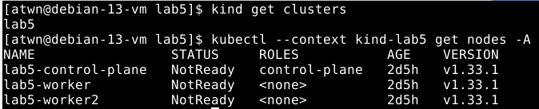
</details>

---

Конфигурация кластера — [`deploy/kind-cluster.yaml`](deploy/kind-cluster.yaml). Поскольку
`kindnet` отключён, ноды остаются `NotReady` до установки CNI.

### Часть 0 — Выбери CNI

Выбран **Calico**. Для этой лаборатории это осознанный выбор в пользу классического
сетевого dataplane: Calico надёжно реализует Kubernetes `NetworkPolicy`, а правила политики
можно сопоставить с привычными механизмами Linux filtering — iptables/nftables и правилами,
которые устанавливает Felix. Поэтому нам будет проще связать абстракции Kubernetes
(`NetworkPolicy`, pod labels, ingress/egress) с тем, что реально происходит на ноде.

Calico подходит для задачи zero-trust не хуже Cilium: ограничения строятся по labels и портам,
а не по эфемерным pod IP. При этом мы сознательно не включаем Calico eBPF dataplane, чтобы
не смешивать в одной работе два разных механизма доставки и enforcement.

Calico не предоставляет Hubble, поэтому используем его собственный путь наблюдаемости:

- **Goldmane** агрегирует сетевые flow logs, включая verdict и сведения о применённой policy;
- **Whisker** показывает эти flows в веб-интерфейсе и позволяет отфильтровать denied traffic по source,
  destination, namespace и policy.

Установка Calico в качестве CNI:
```bash
kubectl --context kind-lab5 create -f \
    https://raw.githubusercontent.com/projectcalico/calico/v3.30.3/manifests/tigera-operator.yaml
kubectl --context kind-lab5 -n tigera-operator wait \
  --for=condition=Available deployment/tigera-operator --timeout=120s
kubectl --context kind-lab5 apply \
  -f deploy/calico-installation.yaml
```

<details>
<summary>Демонстрация</summary>

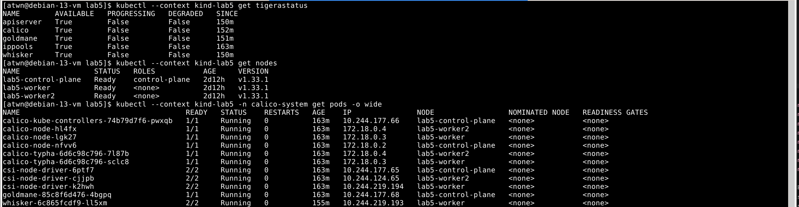
</details>

---

### Часть 1 — Разверни shop и исследуй сеть пода

Развернули сервисы приложения "shop" из 3-й лабораторной на двух worker-нодах в кластере kind.

<details>
<summary>Предустановка</summary>

```bash
# (optional) local-path as default storageclass (unless already provided by kind):
kubectl --context kind-lab5 apply -f \
    https://raw.githubusercontent.com/rancher/local-path-provisioner/v0.0.37/deploy/local-path-storage.yaml
kubectl --context kind-lab5 patch storageclass local-path --type merge \
    -p '{"metadata":{"annotations":{"storageclass.kubernetes.io/is-default-class":"true"}}}'

# CloudNativePG
helm repo add cnpg https://cloudnative-pg.github.io/charts
helm repo update
helm --kube-context kind-lab5 upgrade --install cnpg cnpg/cloudnative-pg \
    --version 0.29.1 \
    --namespace cnpg-system \
    --create-namespace \
    -f platform/cnpg-values.yaml \
    --wait \
    --timeout 10m

# (optional) re-initialize CNI if needed (e.g. when token is expired):
kubectl --context kind-lab5 -n calico-system \
  rollout restart daemonset/calico-node
kubectl --context kind-lab5 -n calico-system \
  rollout status daemonset/calico-node --timeout=180s

# Observability stack (Prometheus + Grafana):
helm --kube-context kind-lab5 upgrade --install kps \
  prometheus-community/kube-prometheus-stack \
  --version 90.1.1 \
  --namespace obs \
  --create-namespace \
  -f deploy/kube-prometheus-stack.yaml \
  --wait --timeout 15m

```
</details>

---

```bash
# build and load images into the kind cluster:
docker build -f Dockerfile.api -t ghcr.io/shop-lab/api:v3 .
docker build -f Dockerfile.worker -t ghcr.io/shop-lab/worker:v2 .

kind load docker-image ghcr.io/shop-lab/api:v3 --name lab5
kind load docker-image ghcr.io/shop-lab/worker:v2 --name lab5

# bring up 'shop' services via Helm:
helm --kube-context kind-lab5 upgrade \
  --install shop charts/shop \
  --namespace shop --create-namespace \
  --wait --timeout 15m
```

<details>
<summary>Демонстрация</summary>

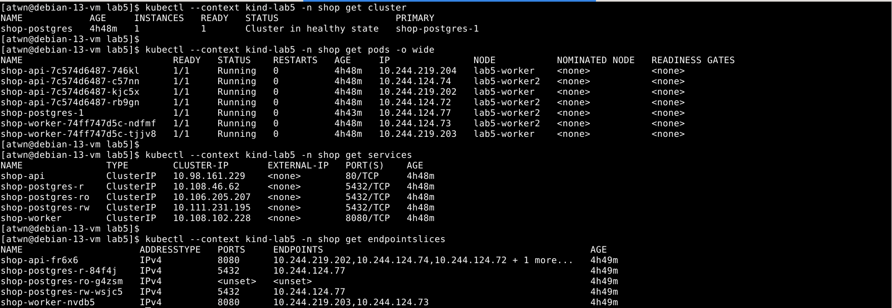
</details>

---

#### Инспекция сети

##### 1. Сеть внутри pod'а

Приняли решение использовать эфемерный debug-контейнер для работы с сетью внутри pod'а,
так как минимальный базовый образ `api` и `worker` не содержит необходимых утилит
(ситуация вполне типичная и для продуктового окружения).

Внутри `api` pod'а на ноде `lab5-worker`:
* `eth0@if19` - интерфейс Pod, соединённый с peer veth-интерфейсом с ifindex 19 на ноде
* `10.244.219.204` - ip адрес виртуального NIC pod'а из пула адресов Calico, совпадает с адресом pod'а на ноде
* `/32` - маска подсети, означает что адрес один, а значит маршрут проходит через виртуальный next-hop
* `169.254.1.1` - виртуальный next-hop, используемый dataplane Calico/Felix для маршрутизации трафика из pod'а
* `10.96.0.10` - ClusterIP CoreDNS кластера, т.е. разрешение имён происходит внутри кластера

<details>
<summary>Демонстрация</summary>

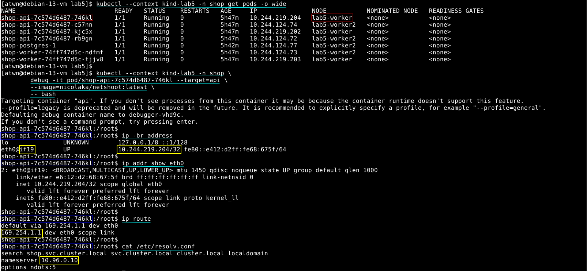
</details>

---

Внутри `worker` pod'а на ноде `lab5-worker-2`:
* `eth0@if16` - интерфейс Pod, соединённый с peer veth-интерфейсом с ifindex 16 на ноде
* `10.244.124.73` - ip адрес виртуального NIC pod'а из пула адресов Calico, совпадает с адресом pod'а на ноде
* `/32` - маска подсети, означает что адрес один, а значит маршрут проходит через виртуальный next-hop
* `169.254.1.1` - виртуальный next-hop, используемый dataplane Calico/Felix для маршрутизации трафика из pod'а
* `10.96.0.10` - ClusterIP CoreDNS кластера, т.е. разрешение имён происходит внутри кластера

<details>
<summary>Демонстрация</summary>

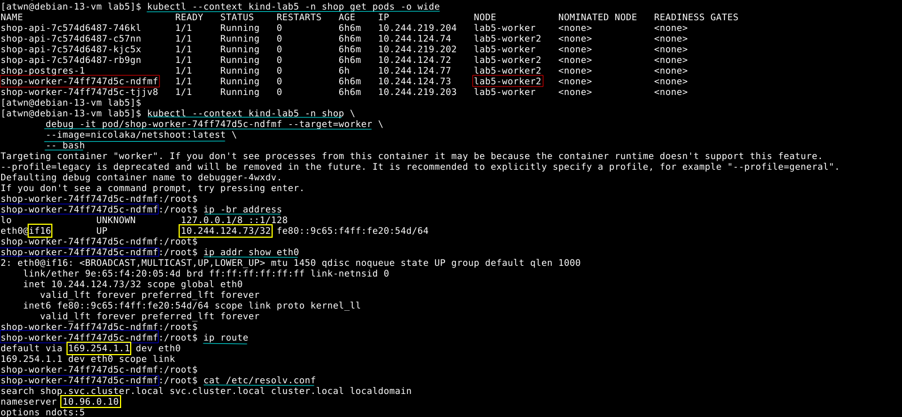
</details>

---

##### 2. Связь pod-интерфейса с veth на ноде

`eth0@if19` означает, что интерфейс Pod соединён с peer veth-интерфейсом
с ifindex 19 на ноде `lab5-worker`. Сам интерфейс `eth0` внутри Pod имеет собственный ifindex.

<details>
<summary>Демонстрация</summary>

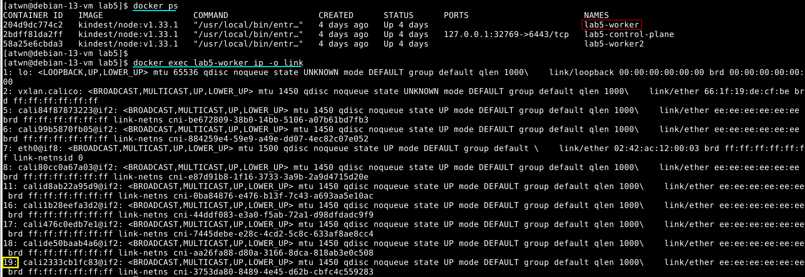
</details>

---

`eth0@if16` означает, что интерфейс Pod соединён с peer veth-интерфейсом
с ifindex 16 на ноде `lab5-worker2`. Сам интерфейс `eth0` внутри Pod имеет собственный ifindex.

<details>
<summary>Демонстрация</summary>

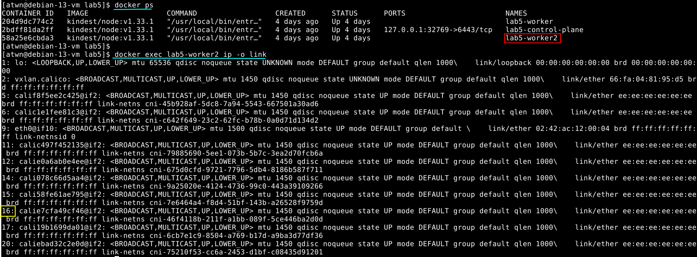
</details>

---

##### 3. Межнодовый трафик

Попробовали достучаться из pod'a `api` в pod `worker` по IP и по DNS-имени.
Для демонстрации выбрали pod'ы, расположенные на двух разных нодах.

<details>
<summary>Демонстрация</summary>

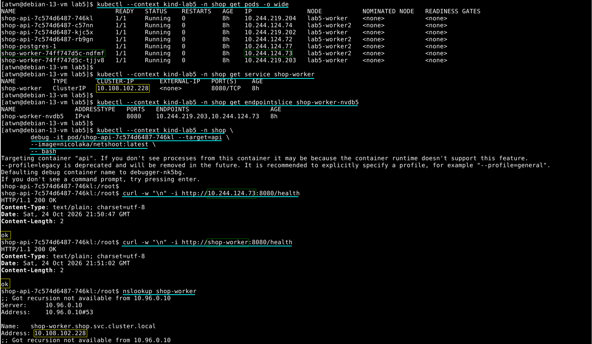
</details>

### Часть 2 — Докажи непрерывность через хаос подов

Заменили ClusterIP на NodePort в конфигурации `api` сервиса в [values.yaml](./charts/shop/values.yaml) и обновили приложение.

```bash
yq -y -i '.api.service.type = "NodePort"' charts/shop/values.yaml

helm --kube-context kind-lab5 --namespace shop \
    upgrade shop charts/shop --reset-values \
    --wait --timeout 5m
```

<details>
<summary>Демонстрация</summary>

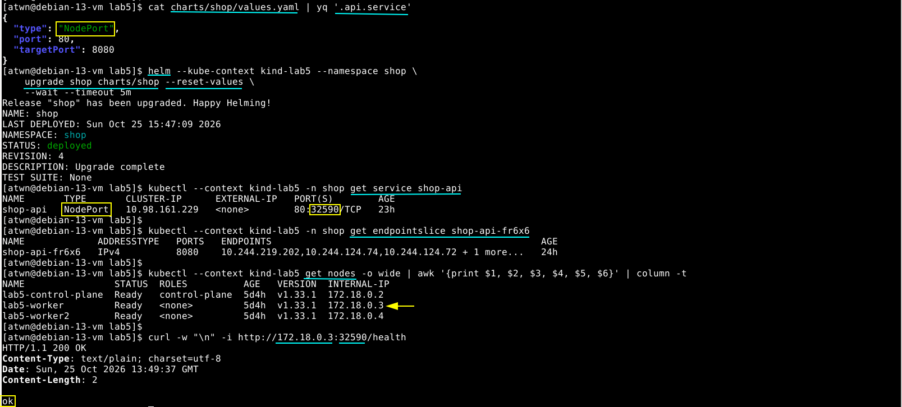
</details>

---

Выводы:

* при наличии NodePort сервис становится доступным извне по IP-адресу ноды
* NodePort не является внешним LoadBalancer и не предоставляет отдельный внешний адрес,
  а kube-proxy по-прежнему выполняет балансировку между эндпоинтами Service'а

#### Запуск хаос-теста

Для проверки непрерывности сервиса подготовили три вспомогательных скрипта:

- [`scripts/load.sh`](./scripts/load.sh) — генерирует запросы к `/health` с заданным
  количеством запросов в секунду и выводит результат, HTTP-статус и latency;
- [`scripts/watch.sh`](./scripts/watch.sh) — показывает состояние Pod'ов либо `EndpointSlice` в режиме обновления раз в секунду;
- [`scripts/chaos.sh`](./scripts/chaos.sh) — каждые 5–10 секунд выбирает случайный `api` Pod и удаляет его.
  После удаления Deployment или другой контроллер восстанавливает нужное количество реплик.

Для повторяемого сбора доказательств дополнительно подготовлены
[`scripts/capture-chaos.py`](./scripts/capture-chaos.py) и
[`scripts/plot-chaos.py`](./scripts/plot-chaos.py): первый собирает запросы, удаления
и состояния Kubernetes за общий интервал, второй строит график по сохранённым данным.
`load.sh` теперь пишет JSON, различает неуспешные HTTP-ответы и ошибки транспорта,
сохраняет exit code `curl`; клиентские повторы запросов не используются.

Для начального сравнения записали контрольный прогон без удаления Pod'ов. В качестве
базовых показателей использовали число успешных и неуспешных запросов, а также
latency. В хаос-тесте дополнительно наблюдали удаления Pod'ов, переходы Pod'ов в
состояния `Terminating`/`Running`, изменение IP-адресов и состава `EndpointSlice`.

<details>
<summary>Демонстрация</summary>

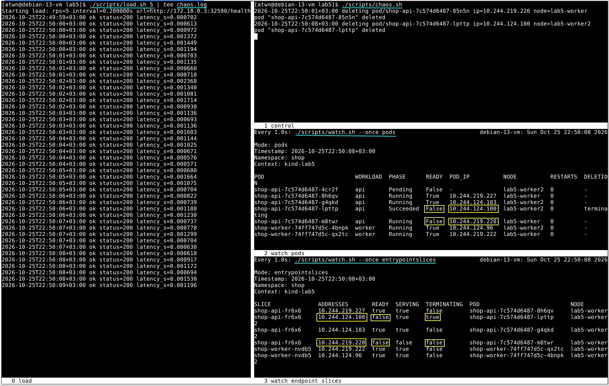
</details>

---

Мы также понаблюдали за тем, как меняются NAT-правила в iptables при удалении одного или нескольких Pod'ов.
Для демонстрации добавили ещё один режим в [watch.sh](./scripts/watch.sh): `./scripts/watch.sh iptables`,
который собирает все записи NAT-правил из iptables по нодам для конкретного ClusterIP (`10.98.161.229`)
и выводит с структурированном виде на экран.

Из интересного: после обновления EndpointSlice kube-proxy удаляет или перестраивает
соответствующую endpoint-ветку `KUBE-SEP` в iptables,
но и меняются коэффициенты между оставшимися правилами, что обеспечивает равномерное распределение трафика
пока число активных подов меньше заданного.

<details>
<summary>Демонстрация</summary>

Записи iptables до удаления пода:

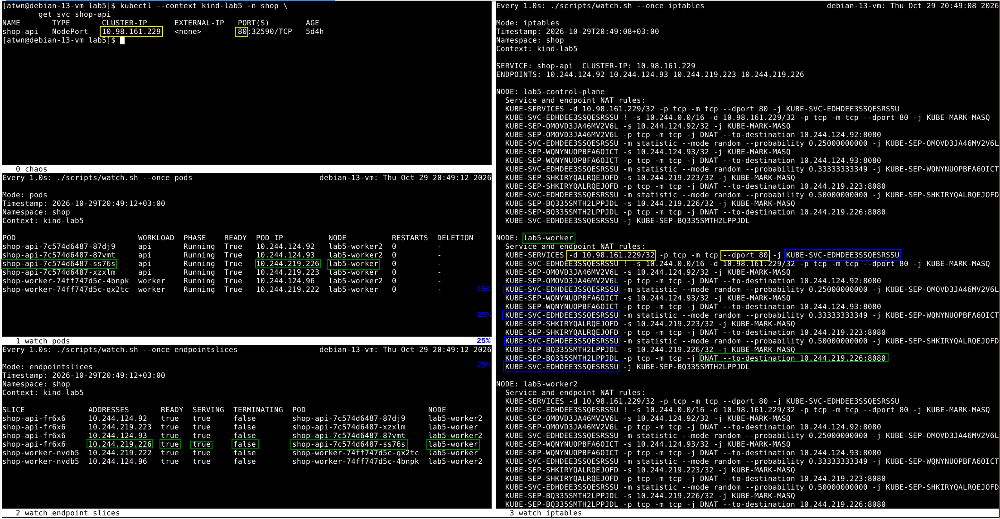

Сразу после удаления пода из `shop-api` и до того, как replacement-под был помечен как Ready в EndpointSlice:

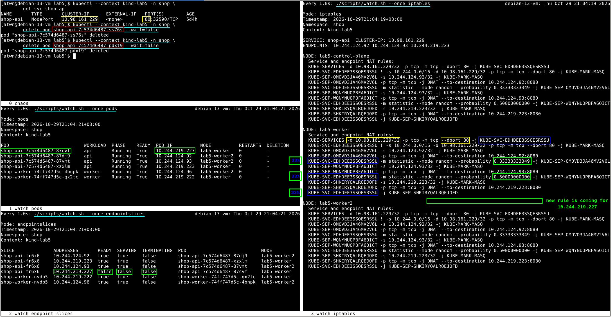
</details>

---

Ещё один интересный факт, который мы зафиксировали: при обращении к эндпоинту по IP-адресу ноды и NodePort,
балансировка происходит не только между эндпоинтами данной конкретной ноды — запрос может попасть и на другие ноды.
Вызвано это, скорее всего, тем, что NAT-правила для каждого сервиса транслируются одинаково на все ноды,
т.е. каждая нода имеет полный набор правил для ClusterIP сервиса, а не только для своих подов
(это можно было увидеть на предыдущей демонстрации, см. [part2-02-iptables-0.png](./scrs/part2-02-iptables-0.png)).
Таким образом, запрос, приходящий на ноду, может быть перенаправлен по внутреннему IP-адресу пода, расположенному на другой ноде.
Такое поведение показалось нам неочевидным.

Ниже приведён пример распределения трафика между нодами после трёх вызовов `curl -w "\n" -i http://172.18.0.3:32590/health`,
где `172.18.0.3` - это внешний IP-адрес ноды `lab5-worker` нашего kind-кластера.
Тот факт, что запрос приходит на разные ноды можно отследить по *rule counters*:

<details>
<summary>Демонстрация</summary>

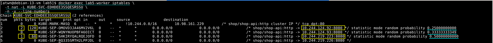
</details>

---

Для визуального сравнения показателей latency в моменты удаления подов решили
построить граф при помощи Grafana + Alloy + Loki.
Для этого поместили генератор трафика в дополнительный под на кластере,
чтобы Alloy смог спарсить логи (см. [load-generator.yaml](./deploy/load-generator.yaml)).
Это также позволило нам задействовать CoreDNS внутри кластера,
а не дёргать `api`-сервис по IP ноды и NodePort, как мы это делали в предыдущем эксперименте.
CoreDNS разрешает имя Service в его ClusterIP. Дальнейший выбор endpoint и DNAT
выполняет kube-proxy; выбранный Pod может находиться на локальной или удалённой ноде.

<details>
<summary>Предустановка</summary>

```bash
# install Loki
helm --kube-context kind-lab5 upgrade --install loki grafana/loki \
  --namespace obs --create-namespace \
  -f deploy/loki.yaml \
  --wait --timeout 15m

# install Alloy
helm --kube-context kind-lab5 upgrade --install alloy grafana/alloy \
  --namespace obs --create-namespace \
  -f deploy/alloy.yaml \
  --wait --timeout 10m

# refresh Grafana dashboards
helm --kube-context kind-lab5 upgrade shop ./charts/shop \
  --namespace shop \
  --reuse-values

# start port-forwarding
./scripts/port-forward.sh start
```

</details>

В [дашборде](./charts/shop/dashboards/shop.json) вывели latency успешных запросов,
все клиентские попытки и ошибки за минуту, а также доступные реплики Deployment.
`sum(up{job="api"})` показывает успешность scrape и используется отдельно от
состояния Pod'ов. Ноль ошибок отображается только при наличии запросов;
отсутствие трафика остаётся `No data`.

<details>
<summary>Демонстрация</summary>

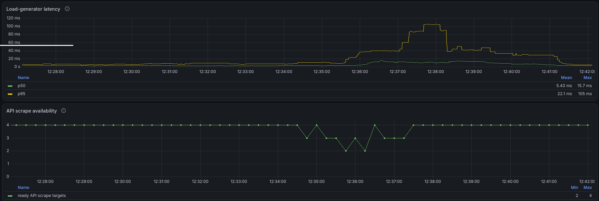
</details>

---

#### Итоговый контрольный прогон

Для корректного завершения API настроили `preStop.sleep: 5s` и общий
`terminationGracePeriodSeconds: 30` в [values.yaml](./charts/shop/values.yaml)
и [Deployment](./charts/shop/templates/api-deployment.yaml). Во время `preStop`
API продолжает принимать запросы, пока обновляется маршрутизация; затем
обрабатывает SIGTERM через `http.Server.Shutdown`. Пауза входит в общий grace period.

<details>
<summary>Предустановка</summary>

На работающем стенде с Deployment `chaos-load`:

```bash
LAB5_RUN_DIR="evidence/part2/manual-$(date +%Y%m%d-%H%M%S)"
python3 scripts/capture-chaos.py "$LAB5_RUN_DIR" \
  --warmup 30 --chaos 180 --cooldown 30 --rps 5
```

Сборщик выполняет нагрузку через NodePort, удаляет случайные API Pod'ы
и сохраняет их IP и состояния EndpointSlice. Логи DNS-запросов к
`shop-api.shop.svc.cluster.local` собираются за тот же интервал.
Длительность — четыре минуты, из них три минуты непрерывного хаоса.
Клиентские повторы запросов не используются.

</details>

Провели контрольный прогон **30 октября 2026 года, 15:06:55–15:10:56 МСК**[^part2-AI].
За три минуты хаоса удалили 24 API Pod'а; им на замену появились 24 новых Pod'а.
За весь интервал наблюдали 28 различных Pod IP с учётом четырёх исходных.

| Клиентский путь | Запросы | Ошибки |
|:--|--:|--:|
| DNS → ClusterIP | 234 | 0 |
| NodePort | 1029 | 0 |

Число Ready endpoints менялось от 2 до 4 и восстановилось до 4.
DNS-генератор не перезапускался. Таким образом, в измеренном интервале
все 1263 запроса завершились успешно при непрерывной замене Pod'ов.

[^part2-AI]: Сценарий и инструменты сбора доказательств подготовили с помощью AI.
    При проверке исходных логов обнаружили неуспешный запрос и добавили задержку
    `preStop`, чтобы снизить риск ошибок во время обновления правил Service.

<details>
<summary>Демонстрация</summary>

Все клиентские попытки и ошибки, удаления, Ready endpoints и смена Pod IP
на общей временной шкале. Жёлтым выделен период хаоса.

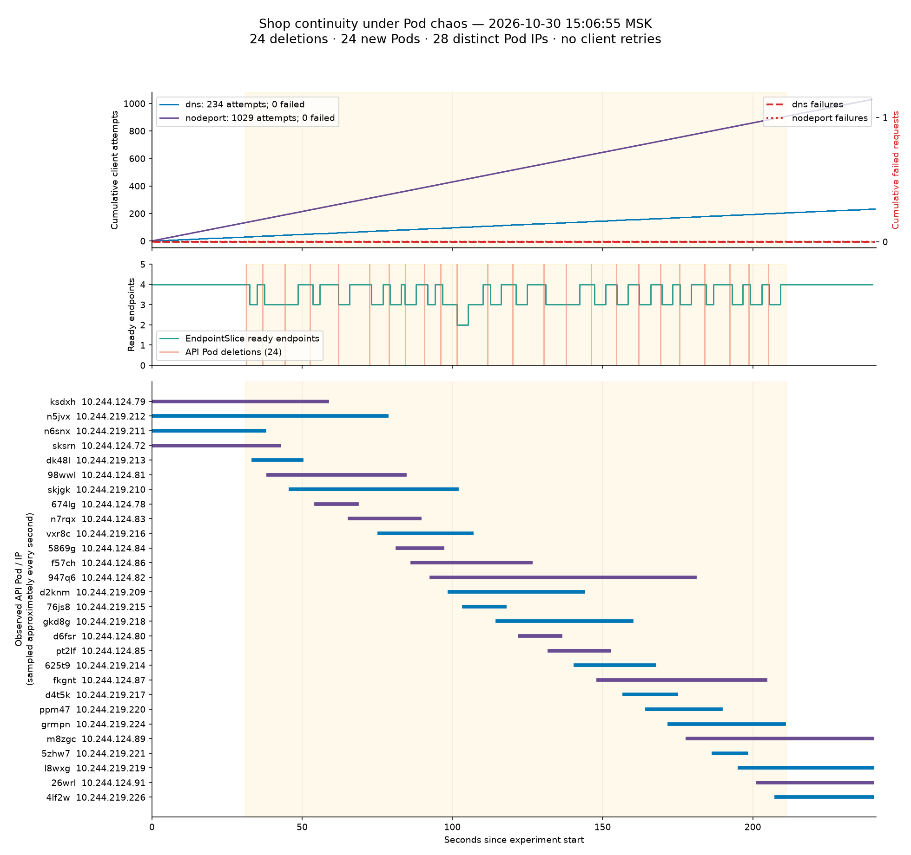

В Grafana показан более широкий интервал, включающий итоговый прогон:
клиентская нагрузка сохраняется, а число ошибок остаётся нулевым.

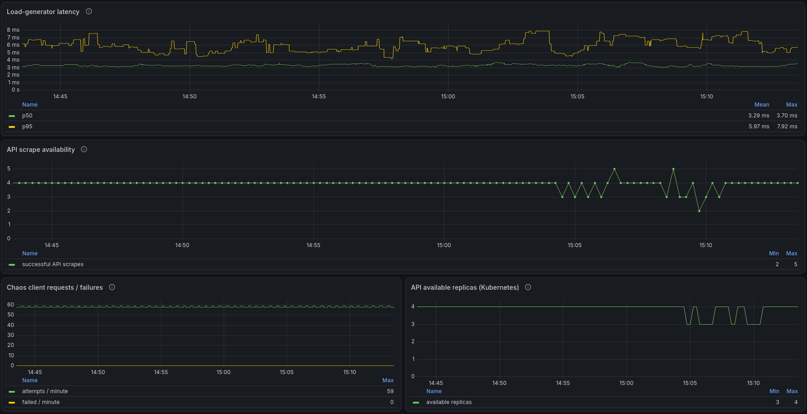

</details>

---

#### Ответы на вопросы части 2

**Чем `NodePort` отличается от `LoadBalancer` и headless-сервиса?**

`NodePort` открывает один и тот же порт на каждой ноде кластера. Запрос к
`NodeIP:NodePort` попадает в Service и затем направляется на один из готовых
backend'ов. Это простой способ предоставить сервис наружу без отдельного
балансировщика. В нашем kind-кластере внешний `load.sh` обращается к
`172.18.0.3:32590` именно через `NodePort`.

`LoadBalancer` — это декларация, что сервису нужен внешний балансировщик. В
облачном Kubernetes соответствующий provider обычно создаёт внешний LB и выдаёт
`EXTERNAL-IP`. В обычном kind-кластере Kubernetes сам по себе не создаёт облачный
балансировщик, поэтому `EXTERNAL-IP` может остаться пустым. Для такой среды
потребовалась бы дополнительная реализация, например MetalLB. Внешний LB затем
может передавать трафик в `NodePort` или напрямую в dataplane — это зависит от
реализации provider'а.

Headless-сервис создаётся с `clusterIP: None`. У него нет виртуального ClusterIP
и обычного Service-level load balancing через kube-proxy. DNS возвращает адреса
самих Pod'ов, а выбор backend'а выполняет клиент или библиотека service discovery.
Такой сервис удобен, когда клиенту нужны индивидуальные адреса реплик, например
для StatefulSet, но он не предназначен для предоставления сервиса наружу
кластера.

**Что происходит при удалении Pod'а?**

Service не является самим Pod'ом. Это стабильная абстракция адресации: ClusterIP и
набор backend'ов, выбранных по label selector. Реальные адреса backend'ов находятся
в `EndpointSlice`.

Когда Pod становится неготовым или удаляется, контроллер EndpointSlice изменяет
состояние соответствующего endpoint. В частности, `conditions.ready` становится
`false` либо endpoint исключается из списка готовых backend'ов. `kube-proxy` следит
за Service и EndpointSlice и обновляет dataplane ноды — в нашем случае правила
Service/DNAT в iptables. Обновление этих правил и отправка SIGTERM контейнеру
происходят асинхронно: приложение может уже закрыть listener, пока старое правило
ещё направляет новые соединения на его endpoint. Поэтому даже при наличии трёх
здоровых реплик отдельный запрос может завершиться ошибкой. Задержка `preStop`
оставляет API принимающим запросы на время распространения обновлений.

Контроллер ReplicaSet, которым управляет Deployment, создаёт замену удалённому
Pod'у. Новый Pod обычно получает другой IP-адрес,
поэтому EndpointSlice изменяется дважды: старый endpoint удаляется или помечается
как недоступный, а новый добавляется после прохождения readiness probe. Именно
поэтому в ходе эксперимента важно было наблюдать не только список Pod'ов, но и
`EndpointSlice`.

**Как взаимодействуют DNS, Service, EndpointSlice и kube-proxy?**

Внутрикластерный генератор разрешает имя
`shop-api.shop.svc.cluster.local` через CoreDNS. DNS возвращает ClusterIP
Service'а `shop-api`, а не адрес конкретного Pod'а.

Далее пакет попадает в dataplane ноды. В нашем кластере kube-proxy работает
в режиме iptables: правило `KUBE-SERVICES` направляет трафик в цепочку
`KUBE-SVC-*`, где выбирается один из готовых endpoint'ов. Цепочка
`KUBE-SEP-*` выполняет DNAT на IP и порт выбранного Pod'а. Если Pod находится
на другой ноде, Calico маршрутизирует пакет между нодами.

EndpointSlice является источником актуального списка endpoint'ов для
kube-proxy. При удалении или потере readiness Pod исключается из выбора,
после чего kube-proxy перестраивает соответствующие iptables-правила.

В данном эксперименте chaos-скрипт удаляет только API-поды, а `/health`
обслуживается оставшимися API-репликами. Поэтому запросы обычно продолжают
завершаться с кодом 200.

**В каком режиме работает kube-proxy и когда заметна разница?**

В этом кластере kube-proxy работает в режиме `iptables`. На это указывают
цепочки `KUBE-SERVICES`, `KUBE-SVC-*` и `KUBE-SEP-*`, наблюдаемые в таблице
`nat`. Режим работы также можно проверить, посмотрев конфигурацию соответствующего ConfigMap:

<details>
<summary>Демонстрация</summary>

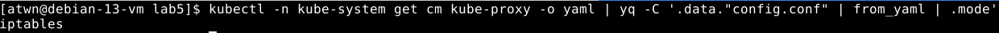
</details>

В режиме iptables kube-proxy реализует выбор endpoint'а цепочкой правил
NAT. В режиме IPVS Service'ы и endpoint'ы представлены как виртуальные
сервисы и real servers в IPVS.

В небольшом кластере разница обычно почти незаметна функционально: оба
режима обеспечивают Service-маршрутизацию и балансировку. Она становится
заметнее при большом количестве Service'ов и endpoint'ов: iptables требует
поддерживать длинные цепочки правил, а IPVS использует отдельные структуры
ядра для поиска backend'а. В нашем эксперименте наблюдается
именно изменение iptables-правил после обновления EndpointSlice.

### Часть 3 — Спроектируй целевую матрицу доступа

До введения ограничений проверили доступ постороннего Pod'а к PostgreSQL.
В namespace `shop` Kubernetes NetworkPolicy отсутствовали. Pod с label
`app.kubernetes.io/name=matrix-probe`, без labels API/worker, получил ответ БД.

<details>
<summary>Предустановка</summary>

```bash
k() { kubectl --context kind-lab5 -n shop "$@"; }
LAB5_PROBE="matrix-probe-$(date +%s)"
LAB5_PG_IMAGE=$(k get pods -l cnpg.io/cluster=shop-postgres \
  -o jsonpath='{.items[0].spec.containers[?(@.name=="postgres")].image}')

k run "$LAB5_PROBE" --image="$LAB5_PG_IMAGE" \
  --image-pull-policy=IfNotPresent --restart=Never \
  --labels='app.kubernetes.io/name=matrix-probe' --command -- sleep 600
k wait --for=condition=Ready "pod/$LAB5_PROBE" --timeout=120s

# Исходные политики, идентичность клиента и результат подключения.
k get networkpolicy
k get pod "$LAB5_PROBE" -o wide --show-labels
k exec "$LAB5_PROBE" -- pg_isready -h shop-postgres-rw -p 5432 -t 3
printf 'Exit code: %s\n' "$?"

# После проверки удаляем временный Pod.
k delete pod "$LAB5_PROBE" --wait=false
```

Для временного Pod используем образ текущей БД, содержащий `pg_isready`.
Пароль БД для этой проверки не используется.

</details>

<details>
<summary>Демонстрация</summary>

Получили `accepting connections`: PostgreSQL доступен по сети
из постороннего Pod'а. Эта проверка не подтверждает право читать данные.

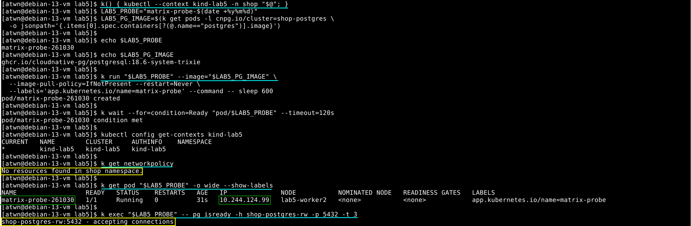

</details>

#### Целевая матрица

Выбрали default-deny для ingress и egress Pod'ов namespace `shop`.
Матрица описывает новые соединения; ответный трафик разрешённых соединений
пропускается автоматически. Состояние «разрешено» ниже — проектное требование,
которое проверим после применения политик.

| Источник | Назначение | Протокол / порт назначения | Решение |
|:--|:--|:--|:--|
| Клиент стенда через NodePort | API | TCP: NodePort `32590` → Pod `8080` | Разрешить |
| `chaos-load` | API | TCP: Service `80` → Pod `8080` | Разрешить |
| API | PostgreSQL | TCP `5432` | Разрешить |
| worker | PostgreSQL | TCP `5432` | Разрешить |
| API | worker | Любой | Запретить |
| worker | API | Любой | Запретить |
| `chaos-load` | worker, PostgreSQL | Любой | Запретить |
| Посторонний Pod | API, worker, PostgreSQL | Любой | Запретить |
| API, worker, PostgreSQL, `chaos-load` | CoreDNS | UDP и TCP `53` | Разрешить |
| Prometheus из `obs` | API, worker | TCP `8080` | Разрешить |
| Оператор CNPG из `cnpg-system` | PostgreSQL | TCP `8000`, `5432` | Разрешить |
| Instance manager в Pod PostgreSQL | Kubernetes API | TCP: Service `443` → endpoint `6443` | Разрешить |
| Pod'ы `shop` | Интернет и остальные направления | Любой | Запретить |

Последняя строка относится к направлениям, не перечисленным в разрешениях.
Прямой обмен между API и worker не нужен: API записывает заказы в PostgreSQL,
а worker асинхронно забирает их из БД. DNS разрешаем отдельно: разрешение TCP
`5432` не позволяет отправить DNS-запрос для определения адреса Service.

Служебные связи CNPG нужны для управления БД и обращения instance manager
к Kubernetes API. В текущем стенде одна PostgreSQL-реплика; межподовая
репликация не требуется. Требования оператора описаны в
[документации CNPG](https://cloudnative-pg.io/docs/1.26/networking/).

#### Идентификация участников

Используем namespace и устойчивые labels вместо Pod IP:

| Участник | Namespace | Labels |
|:--|:--|:--|
| API / worker | `shop` | `app.kubernetes.io/instance=shop` и `app.kubernetes.io/name=api` / `worker` |
| PostgreSQL | `shop` | `cnpg.io/cluster=shop-postgres` |
| Генератор нагрузки | `shop` | `app.kubernetes.io/name=chaos-load` |
| CoreDNS | `kube-system` | `k8s-app=kube-dns` |
| Prometheus | `obs` | `app.kubernetes.io/name=prometheus`, `prometheus=kps-prometheus` |
| Оператор CNPG | `cnpg-system` | `app.kubernetes.io/name=cloudnative-pg`, `app.kubernetes.io/instance=cnpg` |

У Pod PostgreSQL `app.kubernetes.io/instance=shop-postgres`, поэтому общий
селектор `instance=shop` его не выбирает. Для внешнего клиента через NodePort
учитываем адрес источника после NAT; pod labels к нему неприменимы.
NetworkPolicy ограничивает IP и порты, поэтому доступ Prometheus к `8080`
не ограничивается HTTP-путём `/metrics`.
