# Лабораторная работа 6 — Autopilot release

## Стенд

| Компонент | Значение |
| --- | --- |
| Кластер | k3d, Kubernetes v1.35.5+k3s1, одна нода |
| Helm | 4.3.0 |
| База данных | CloudNativePG 1.30.1, PostgreSQL 18.6 |
| Мониторинг | kube-prometheus-stack 91.8.1 |
| Нагрузка | около 10 `POST /order` и 10 `GET /version` в секунду |

Финальные значения chart соответствуют здоровому autopilot-релизу: mesh,
v1/v2, split 90/10 и gate включены, v2 запускается с `FAIL=false`. Для baseline
эти переключатели отключались через `--set`, а для bad-release использовался
`--set api.v2.fail=true`.

## Часть 0 — Сервисы

Стенд перенесли 3 лабы без изменения. Сохраненили Helm chart'ы `shop`, CloudNativePG и две реплики `worker`. 
Worker по-прежнему конкурентно забирает необработанные заказы через `FOR UPDATE SKIP LOCKED`. 
Его намеренно не включили в mesh, потомц что эксперимент ограничен API.

API поддерживает `GET /health`, `GET /version`, `POST /order` и `GET /orders`. 
Переменная `VERSION` выбирает `v1`/`v2`; у v1 переключатель `FLAKY=true` возвращает заданную долю искусственных 500 до записи в БД, а у v2 `FAIL=true` делает неуспешными все `POST /order`.

Сделали отдельный `loadgen` который создаёт постоянную одинаковую нагрузку и экспортирует client-side latency и статусы ответов. 
Благодаря этому результаты до и после mesh измеряются в одной точке. 
Gate каждые 15 секунд читает из Prometheus request rate, error rate и p95 v2, после двух здоровых окон повышает долю v2 на 10%, а при превышении порога немедленно устанавливает её в 0. 
При недоступности метрик или API gate оставляет текущий вес без изменений.

## Часть 1 — Выбор mesh

Выбрали Linkerd. Для однонодового стенда он даёт нужные функции без отдельного L7 waypoint. Автоматический mTLS, retries, traffic split через `HTTPRoute` и метрики до/после retry. 
Последнее нам особенно важно для эксперимента с `FLAKY`. Мы можем одновременно показать реальные ошибки бека и результат, который увидел клиент. 
Но мы получаем sidecar в каждом meshed Pod. И он ест наш ресурс CPU и RAM.

## Часть 2 — baseline без mesh

Baseline снят при установленном control plane Linkerd, но с выключенной инъекцией proxy в workload'ы (`mesh.enabled=false`). 
Работали две реплики `api` v1, `loadgen`, две реплики `worker` и постгря. 
У Pod приложений был только один контейнер, без sidecar. 
После готовности БД и прогрева нагрузки получили следующие значения:

| Метрика | Baseline |
| --- | ---: |
| Client-side p95 `POST /order` | 5.94 ms |
| Ошибки, замеченные клиентом | 0% |
| Фактическая интенсивность `POST /order` | 9.65 req/s |
| API CPU | 23m + 4m = 27m |
| API memory | 10 MiB + 14 MiB = 24 MiB |

Начальные ошибки при старте не включались в baseline. 
Они возникали, пока CloudNativePG выполнял bootstrap и write-service ещё отвечал `connection refused`. 
Для сравнения использовали стабильное 30 секундное окно после перехода `Cluster/shop-postgres` в `Ready`.

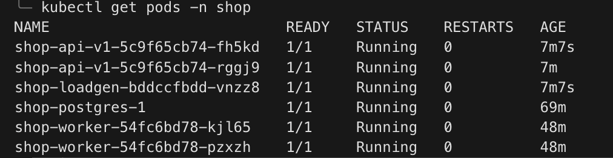

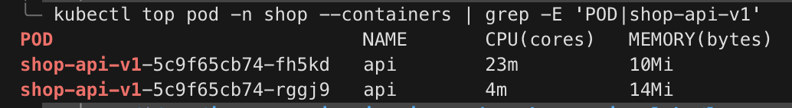

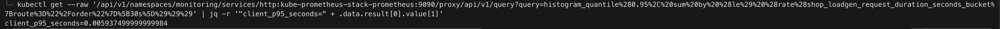

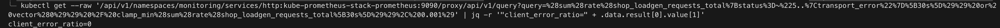

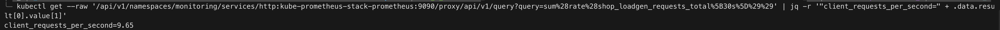

## Часть 3 — Linkerd и mTLS

Linkerd edge-26.10.1 установлен отдельно от приложения вместе с расширением Viz. 
Инъекция включена через значение `mesh.enabled` Helm чарта только для `api` и внутрикластерного `loadgen`, постгрес в mesh не включен. 
После rollout каждый Pod приложения содержит основной контейнер и `linkerd-proxy`.

`linkerd viz edges -o wide` показал ребро `shop-loadgen → shop-api-v1` со значением `SECURED`. 
Клиент показывал identity `shop-loadgen.shop`, сервер `shop-api.shop`.
Команда `linkerd identity` дополнительно показала X.509-сертификат с issuer `identity.linkerd`, subject `shop-loadgen.shop.serviceaccount.identity.linkerd.cluster.local`
и назначением одновременно для TLS аутентификации. 
Следовательно, соединение не только зашифровано, но и обе стороны аутентифицированы общей CA mesh.

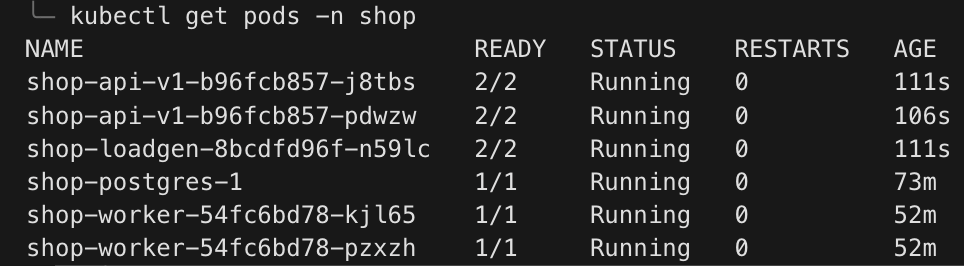

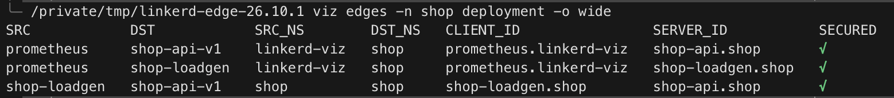

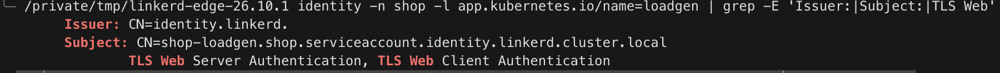

## Часть 4 — Надежность без изменений приложения

Для v1 вклюсили `FLAKY=true` с вероятностью ошибки `0.30`. 
На привязанном к Service `HTTPRoute` настроили повторные попытки ответов HTTP 500. 
Сделали не более двух retry с таймаутом 500 ms на попытку. 
Linkerd политику принял с условиями `Accepted=True` и `ResolvedRefs=True`.

На одном временном интервале метрики приложения показывают около 30% ошибок бека, но успешность, измеренная клиентом после обработки mesh, остаётся почти 100%. 
`linkerd viz stat-outbound` подтвердил причину расхождения, маршрут `shop-api` имеет `RETRIES=14.59%`, и итоговую успешность 99.02%, а отдельные обращения на бек успешны только в 84.58%. 
Получается, что эффект обеспечили именно ретраи исходящего proxy `shop-loadgen`.

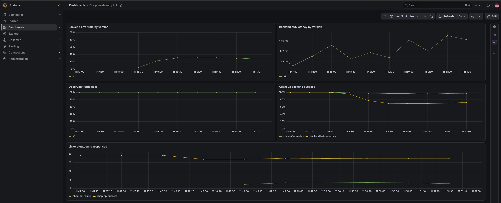

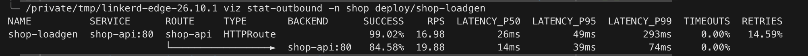

## Часть 5 — Одновременные v1/v2 и traffic split

Chart разворачивает две реплики v1 и одну реплику v2.
Linkerd `HTTPRoute`, также созданный chart, направляет запросы к backendRefs с весами `shop-api=90` и `shop-api-v2=10`. 
Meshed `loadgen` непрерывно вызывает `GET /version`. Поэтому его счётчик измеряет фактический, а не заданный split после прохождения outbound proxy.

На минутном окне получили `v1=91%`, `v2=9%`.

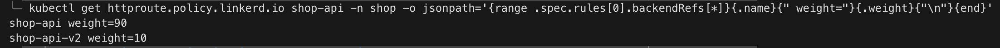

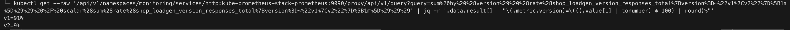

## Часть 6 — Логика autopilot

Gate запустили с отдельным ServiceAccount и минимальным namespaced RBAC,`get`/`patch` только для `HTTPRoute/shop-api`. 
Сначала он устанавливает v2 вес 10% и выдерживает нагрузку 60 секунд, чтобы Prometheus не смешивал метрики предыдущей и новой ревизий. 
Затем каждые 15 секунд gate читает:

- request rate v2, чтобы не принимать решение без достаточной выборки;
- долю HTTP 5xx v2, порог — 5%;
- application p95 v2, порог — 500 ms.

Два последовательных здоровых окна повышают вес v2 на 10%.
Любое нарушение error rate или latency порога немедленно меняет веса на `v1=100`, `v2=0`.
Недоступные метрики и недостаточный поток приводят к `hold`, а не к promotion. 
Gate использует JSON Patch Kubernetes API. 
При последующем `helm upgrade` Helm 4 требует `--force-conflicts`, поскольку chart и runtime controller намеренно изменяют одни и те же поля веса

## Часть 7 — Bad и good release

### Плохой релиз :(

v2 была развёрнута с `FAIL=true` при начальном весе 10%. 
После warm up gate увидел `error_rate=1.000` и самостоятельно выполнил rollback. 
Итоговый `HTTPRoute`: `shop-api=100`, `shop-api-v2=0`. 
Grafana одновременно показывает 100% backend errors v2 и исчезновение её фактической доли трафика

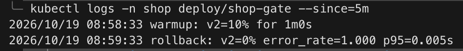

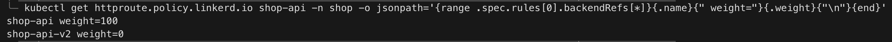

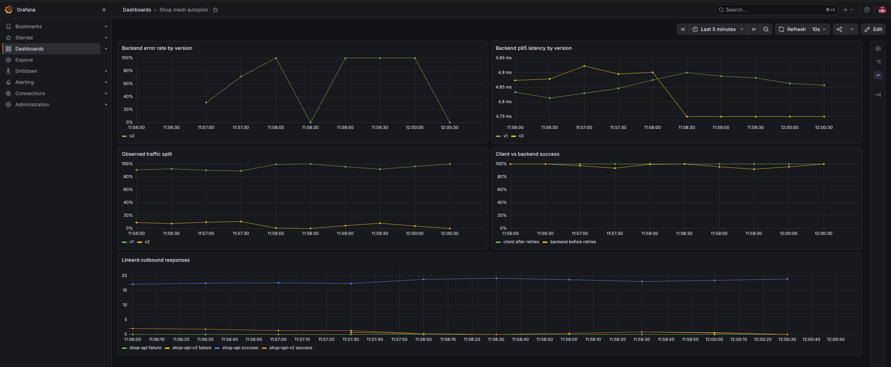

### Здоровый релиз :)

После развёртывания v2 с `FAIL=false` и очистки окна gate начал с 10%. 
При `error_rate=0` и p95 около 5 ms он последовательно изменял вес на 20%, 30%, …, 100%, после чего зафиксировал `promotion complete`. 
Итоговый `HTTPRoute`: `shop-api=0`, `shop-api-v2=100`. 
На графике фактическая доля, измеренная ответами `GET /version`, плавно переходит с v1 на v2.
Отсутствие серии в панели error rate означает, что временной ряд HTTP 500 не возникал

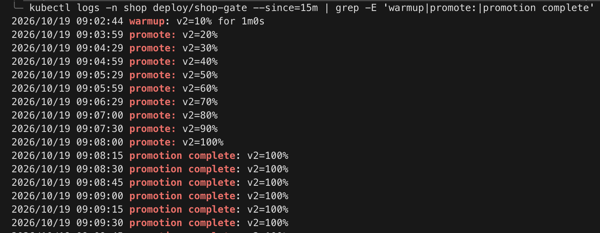

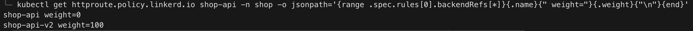

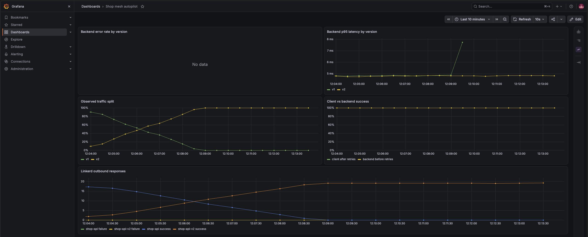

## Часть 8 — Стоимость mesh и вывод

Для сравнения восстановлена та же топология, что использовалась в baseline:
две реплики здоровой v1 и один loadgen, без v2, gate и traffic split. 
Отличие — наличие Linkerd proxy у API и loadgen. 
Стенд багополучно не потушили на ночь и он накопил 76 MB заказов, пожтому перед повтором тестовая таблица `orders` была очищена, а API/loadgen Pod пересозданы.

| Метрика | Без mesh | С mesh | Изменение |
| --- | ---: | ---: | ---: |
| Client-side p95 `POST /order` | 5.940 ms | 11.125 ms | +5.185 ms (+87.3%) |
| API CPU, всего | 27m | 32m | +5m (+18.5%) |
| API memory, всего | 24 MiB | 46 MiB | +22 MiB (+91.7%) |

В mesh-снимке контейнеры приложения занимали `14m CPU` и `31 MiB`, а два `linkerd-proxy` отдельно — `18m CPU` и `15 MiB`. 
CPU взят из моментального `kubectl top`, поэтому это наиболее шумная оценка. 
Сравнивать следует суммарные значения одинаковой топологии, а не разницу отдельных реплик.

Для такого маленького стенда постоянный sidecar mesh не оправдан: почти двукратный рост памяти и p95 на 87% слишком велики для числа межсервисных связей.
Linkerd оправдан, только если требования к обязательному mTLS важнее этой цены. 
Для данной системы практичнее оставить TLS на границе и выполнять progressive delivery отдельным rollout-controller'ом

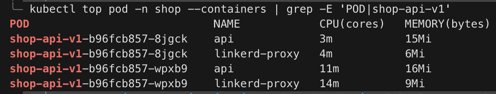

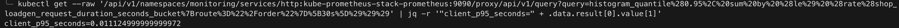

## Часть 9 — Мониторинг и алерты

Chart создаёт `ServiceMonitor/shop` для application/loadgen/worker metrics и `PodMonitor/shop-linkerd-proxies` для admin endpoint sidecar. Grafana dashboard
`Shop mesh autopilot` загружается из ConfigMap и содержит backend error rate и p95 по версиям, фактический traffic split по ответам `GET /version`, сравнение client/backend success и Linkerd outbound responses.

В `PrometheusRule/shop` определены три правила:

1. `ShopCanaryHighErrorRate` (`critical`) — срабатывает, когда error rate v2
   выше 5% в течение минуты. Это основной сигнал немедленного rollback.
2. `ShopCanaryHighLatencyP95` (`warning`) — срабатывает при p95 v2 выше 500 ms.
   Успешные, но медленные ответы не видны через 500, однако также делают promotion небезопасным.
3. `ShopLinkerdProxyNotReady` (`critical`) — обнаруживает неготовый `linkerd-proxy`. 
4. При таком состоянии теряются гарантии data plane: mTLS, routing, retries и mesh-метрики, поэтому проблема критична независимо от здоровья процесса приложения.

Prometheus загрузил все три правила с `health=ok`

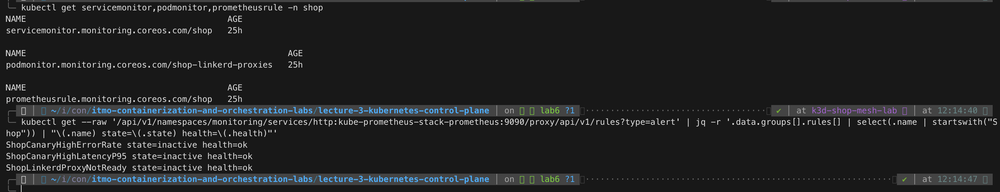
