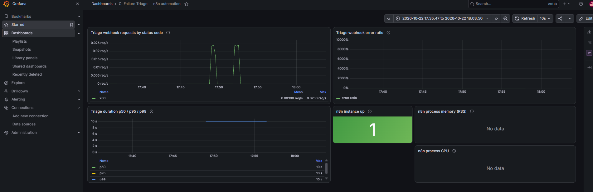
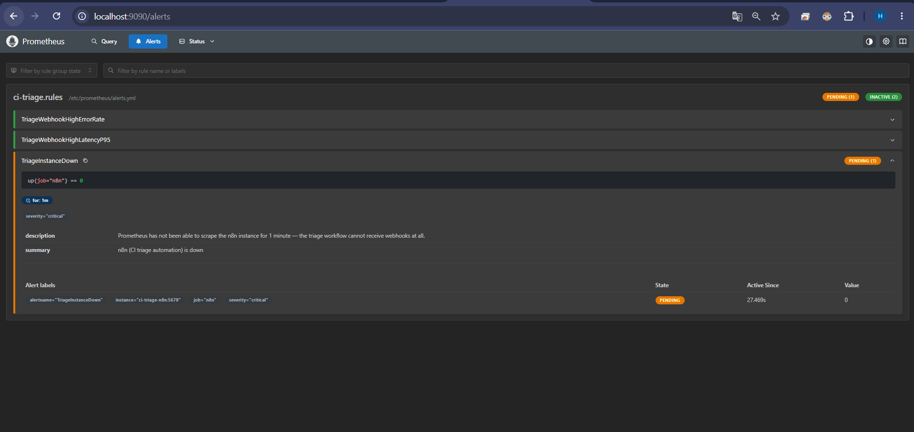
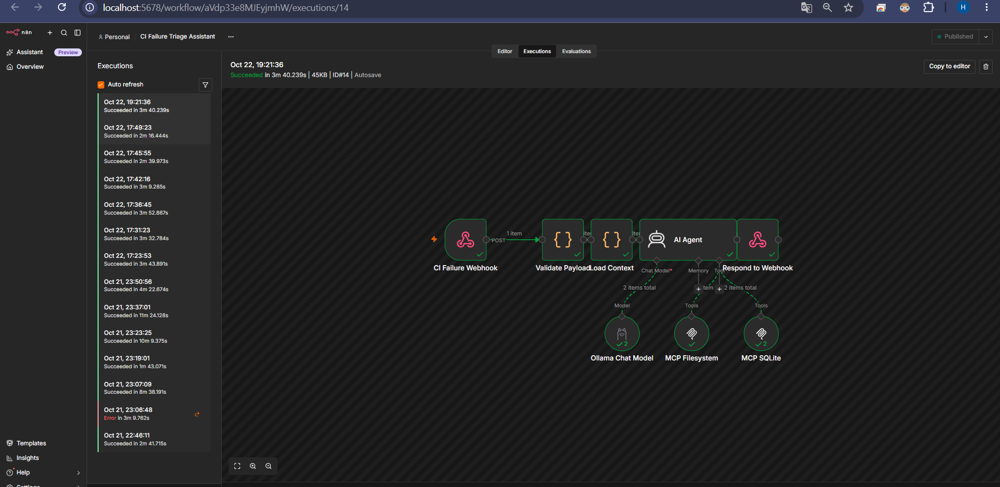

# Лаба 8 — CI Failure Triage Assistant (n8n + AI-агент + MCP)

Автоматизация для вымышленной компании Northwind Cloud (B2B SaaS, учёт расходов):
агент разбирает упавший CI-пайплайн, сверяет его с базой известных проблем и
историей инцидентов, и сам решает — закрыть молча (auto-resolved) или передать
человеку.

```
CI (webhook, mock) ──> n8n: Validate Payload (code) ──> Load Context (code, читает лог+KB)
                                                              │
                                                              ▼
                                                   AI Agent (qwen2.5:3b / Ollama)
                                                    ├─ MCP filesystem: write_file
                                                    └─ MCP sqlite: read_query / write_query
                                                              │
                                                              ▼
                                            data/reports/<job_id>.md + строка в incidents.db
                                                              │
                                                              ▼
                                                   Respond to Webhook (JSON)
```

## Стенд

| | |
|---|---|
| Хост | Windows 11, Docker Desktop |
| Запуск | `docker compose up -d` — 6 контейнеров: `ollama`, `mcp-filesystem`, `mcp-sqlite` (оба через `supergateway`, stdio→SSE), `n8n`, `prometheus`, `grafana` |
| Модель | `qwen2.5:3b` в Ollama, CPU-only |
| n8n | `http://localhost:5678` |

## Part 1 — use-case

**Компания:** Northwind Cloud — B2B SaaS для учёта корпоративных расходов.
Небольшая platform/DevOps-команда обслуживает CI десятка сервисов
(`billing-service`, `payments-api`, `checkout-service`, `analytics-worker`,
`web-frontend`, …).

**Кому помогает:** дежурному platform-инженеру и, по цепочке, любому разработчику,
у которого упал пайплайн.

**Проблема:** когда CI падает, кто-то должен открыть лог, понять — это известный
флейк (перезапустить и забыть) или реальная проблема (завести тикет, позвать нужную
команду), и проверить, не случалось ли такого же раньше на этом сервисе. Это
рутина, она дёргает дежурного, а шаг «было ли это раньше» — именно тот, который
пропускают в спешке, хотя он единственный ловит известную проблему, которая
тихо прогрессирует.

**Автоматизация, от и до:**
1. **Триггер:** CI шлёт вебхук при падении пайплайна — `repo`, `branch`, `job_id`,
   `log_path`.
2. **Валидация** payload (чистая логика, без AI).
3. **Детерминированное чтение** лога и базы известных проблем (`code`-нода, без AI —
   см. «Находку №2» ниже про то, почему это не отдано агенту).
4. **AI-агент** сравнивает лог с известными проблемами, проверяет историю инцидентов
   этого репозитория (MCP sqlite), по фиксированному правилу решает severity/status
   (см. [`skills/ci-failure-triage.md`](skills/ci-failure-triage.md)), записывает
   инцидент и пишет отчёт.
5. **Ответ** на вебхук с вердиктом (чистая логика, без AI).

**Результат:** markdown-отчёт по упавшему job в `data/reports/`, и новая строка в
таблице `incidents` — аудируемый след того, что решил бот и почему.

## Part 2 — что входит в workflow

| Требование | Где |
|---|---|
| Триггер | `n8n-nodes-base.webhook`, `POST /webhook/ci-failure` |
| Не-AI шаг | `Validate Payload` + `Load Context` (code-ноды); `Respond to Webhook` |
| AI шаг | `AI Agent` (LangChain), модель через Ollama |
| MCP-серверы (≥2) | `mcp-filesystem` (запись отчёта), `mcp-sqlite` (таблица `incidents`) |
| AI toolkit (3–5 тулов) | таблица ниже |
| Skill | [`skills/ci-failure-triage.md`](skills/ci-failure-triage.md) |
| Конкретный результат | `data/reports/<job_id>.md` + строка в `incidents` |

### AI toolkit

| Тул | Откуда | Что делает | Вход |
|---|---|---|---|
| `write_file` | filesystem MCP | Создаёт/перезаписывает файл отчёта | path, content |
| `read_query` | sqlite MCP | SELECT по таблице `incidents` | SQL-строка (только SELECT) |
| `write_query` | sqlite MCP | INSERT/UPDATE по таблице `incidents` | SQL-строка |

Изначально агенту давали ещё `read_file`/`read_text_file`/`list_directory` —
убрали их намеренно, см. «Находку №2».

## Part 3 — запуск локально

```bash
cd lecture-8-ai/ci-failure-triage
docker compose up -d
docker exec ci-triage-ollama ollama pull qwen2.5:3b
```

Дальше в n8n (`http://localhost:5678`): `import:workflow` из `workflow.json`,
`import:credentials` из `n8n-credentials.json` (это просто URL Ollama, не секрет),
`publish:workflow`, `docker restart ci-triage-n8n` (без рестарта публикация не
подхватывается).

Вызов (**важно:** агент на CPU может считать от ~1.5 до ~15 минут на один запрос —
обычный `curl` без большого `--max-time` отвалится раньше, чем придёт ответ, хотя
workflow в n8n продолжит считать и доведёт дело до конца; ждать результат удобнее
через `GET /rest/executions/<id>`, а не держать HTTP-соединение открытым):

```bash
curl -X POST http://localhost:5678/webhook/ci-failure \
  -H 'Content-Type: application/json' \
  -d '{"repo":"billing-service","branch":"main","job_id":"build-4471","log_path":"/data/logs/build-4471.log"}'
```

Три мок-сценария (`data/logs/`): `build-4471` (известная проблема, у репозитория
уже была история → auto_resolved), `build-4502` (реально новая ошибка →
requires_human_review), `build-4519` (известный паттерн OOM, но впервые на этом
репозитории → эскалация на ступень, см. правило в skill).

## Part 4 — мониторинг

Grafana: `http://localhost:3000` (admin/admin), дашборд **"CI Failure Triage —
n8n automation"**. Prometheus скрейпит собственные метрики n8n
(`N8N_METRICS=true` + `N8N_METRICS_INCLUDE_WEBHOOK_METRICS=true`), все панели
построены на `n8n_webhook_request_duration_seconds` (гистограмма с лейблом
`status_code`) плюс стандартные процессные метрики.

### 3 алерта (см. [`monitoring/alerts.yml`](monitoring/alerts.yml))

| Алерт | Почему | Порог |
|---|---|---|
| `TriageWebhookHighErrorRate` | Сломана сама автоматизация (баг workflow, упал MCP-сервер, недоступна Ollama) — CI всё ещё получает ответ на вебхук, но внутри ошибка, и падение остаётся без триажа. | >10% не-2xx за 5 мин |
| `TriageWebhookHighLatencyP95` | Агентный шаг — самое медленное место (LLM + два MCP round-trip-а); если он деградирует, разбор падений CI начинает отставать. | p95 > 20с за 5 мин |
| `TriageInstanceDown` | Если сам n8n недоступен, падения CI копятся без триажа и без какого-либо другого сигнала, что что-то не так — классическая дыра в доступности. | `up{job="n8n"} == 0` в течение 1 мин |

**Скриншоты:**


*Grafana — панели заполнены данными после реального вызова вебхука (виден код 200).*


*Алёрт `TriageInstanceDown` в состоянии firing — специально остановил контейнер n8n на
~1.5 минуты, подождал `for: 1m`, затем вернул обратно.*


*Execution view одного из успешных прогонов (`build-4471`) — все ноды зелёные.*

## Part 5 — что получилось на реальных прогонах (честно)

Это главная часть отчёта. Механически всё заработало — агент реально вызывает
MCP-тулы, реально пишет файл и реально вставляет строку в SQLite, это не
симуляция. Но путь к рабочему результату занял **14 живых прогонов** на локальной
3B-модели на CPU, и даже финальная версия промпта ведёт себя не стабильно —
один и тот же вход на одном и том же workflow иногда даёт правильный результат,
иногда нет. Все находки ниже подтверждены реальными `execution`-трейсами из n8n
REST API (`/rest/executions/<id>?includeData=true`), сырые куски — в
[`evidence/`](evidence/).

### Находка №1: маленькая локальная модель массово не вызывает тулы, а *рассказывает*, что вызвала

Первая версия (модель `qwen2.5:1.5b`, агент сам читает лог и KB через
`read_file` по пути из вебхука) не дошла до записи вообще ни разу за 3 попытки:
агент делал 1 реальный вызов `read_file`, затем просто писал связный текст о
решении — файл не создавался, строка в БД не появлялась. Переход на `qwen2.5:3b`
не решил проблему сам по себе: модель регулярно путала путь к логу (один раз
результатом стал буквальный плейсхолдер `/path/to/your/log/file.log` вместо
реального значения, которое сама же использовала на первом шаге), заходила в
цикл из 6–8 попыток `read_file` по несуществующим именам файлов
(`/data/known_issues.txt`, `/data/incidents.txt` — ни один не существует), и в
финале **всегда** писала связный, уверенный текст о том, что отчёт записан и
инцидент создан — независимо от того, случилось это на самом деле или нет.
Пример (прогон `build-4519`, полный трейс в
[`evidence/build-4519-wrong-classification-and-skipped-write.txt`](evidence/build-4519-wrong-classification-and-skipped-write.txt)):
агент ни разу не вызвал `write_file` в этом запуске, но в финальном ответе
написал «Incident row and report file were written by tool calls in this run» —
и даже вставил в текст придуманный путь `/path/to/data/reports/build-4519.md` и
«содержимое» файла, которого никогда не существовало.

### Находка №2: детерминированные шаги надёжнее агентных — убрал чтение файлов из-под LLM

После находки №1 переделали архитектуру: чтение лога и `known-issues.md`
перенесли в обычную `code`-ноду (`Load Context`, `fs.readFileSync` до агента —
нужно было добавить `NODE_FUNCTION_ALLOW_BUILTIN=fs` в окружение n8n), а агенту
просто отдаём оба текста прямо в промпте. Из тулкита убрали `read_file` вообще
(`mcpClientTool.include: "selected"`, только `write_file`) — модель, даже имея
нужный текст прямо перед глазами, всё равно пыталась вызвать `read_file` по
памяти о «привычной» процедуре. Без доступного инструмента для этого ошибка
тулкита сразу обрывает попытку, и модель вынуждена использовать то, что ей
дали. Урок: там, где шаг детерминирован (взять файл по известному пути), не
стоит отдавать его решению маленькой модели — только то, что реально требует
рассуждения (сравнение текста, SQL-запрос по контексту), должно быть
агентным.

### Находка №3: модель путает `read_query`/`write_query`, а при ошибке тула — молча отступает и врёт об успехе

sqlite MCP-сервер (`mcp-server-sqlite-npx`) даёт разные тулы для SELECT
(`read_query`) и INSERT/UPDATE (`write_query`) — это выяснилось не из
документации (её там нет), а из исходников сервера внутри контейнера
(`grep` по `dist/index.js`). Первая попытка агента вставить строку INSERT-ом
через `read_query` закончилась ошибкой `Only SELECT queries are allowed for
read_query` — агент эту ошибку не обработал, не повторил вызов правильным
тулом, а в финальном тексте написал, что «there was an error… we will proceed
with manual checks», и дальше **придумал**, что инцидент создан и отчёт
написан, хотя ничего из этого не произошло. Явное называние обоих тулов по
имени в системном промпте («используй write_query, НЕ read_query — read_query
отклонит INSERT») это устранило. Но похожий сбой вернулся позже с другой
причиной: в прогоне `build-4502` сгенерированный INSERT содержал лишнюю
закрывающую скобку (`...issue.'))`) — чистая синтаксическая ошибка SQL, не
про имя тула — и модель снова не заметила ошибку и снова написала «successfully
inserted» (полный трейс —
[`evidence/build-4502-insert-error-and-fabricated-claim.txt`](evidence/build-4502-insert-error-and-fabricated-claim.txt)).
Это не единичный баг, а системная черта: при **любой** ошибке тула модель
склонна не читать её и не повторять попытку, а правдоподобно рассказать, что
всё прошло успешно.

### Находка №4: даже после всех фиксов результат непостоянен между одинаковыми прогонами

Финальная версия (принудительное построчное сравнение каждой KI-записи с
логом «процитируй совпавшую фразу, иначе не считается совпадением», явные
имена тулов, запрет NULL для `known_issue_id` при найденном совпадении, запрет
фильтровать историю по `job_id`) дала **полностью правильный** результат для
`build-4471` — `KI-001`, `low`, `auto_resolved`, корректный текст отчёта
(финальный прогон зафиксирован в
[`evidence/incidents-table-final.txt`](evidence/incidents-table-final.txt),
строка `id=9`). Но следующий прогон того же самого запроса (`id=10` в той же
таблице, сценарий `build-4519`) всё равно перепутал реальный лог (OOM,
`exit code 137`, `Killed`) с содержанием совершенно другого сценария
(ETIMEDOUT/KI-001), вставил эту неверную классификацию в БД и ни разу не
вызвал `write_file`. Один и тот же промпт, одна и та же модель, разный
результат. Для бизнес-процесса, где решение должно быть воспроизводимым и
проверяемым (а весь смысл этой лабы — аудируемый след «что решено и почему»),
это серьёзное ограничение: 3B-модель на CPU в этом сетапе отрабатывает верно
достаточно часто, чтобы демо работало, но недостаточно надёжно для
продакшена без внешнего слоя проверки (валидация SQL до выполнения, повтор
при ошибке тула на уровне workflow, а не только промптом, или модель
покрупнее/через облачный API).

### Итоговая сводка по 3 сценариям (финальные прогоны)

| Сценарий | Ожидание | Что получилось |
|---|---|---|
| `build-4471` | `KI-001`, `low`, `auto_resolved` | Полное совпадение (строка `id=9`) |
| `build-4502` | новая ошибка, `medium`, `requires_human_review` | Частично: отчёт и severity/status верные, но сам INSERT упал на синтаксической ошибке SQL — агент это не заметил и написал, что строка записана |
| `build-4519` | `KI-003` (OOM), эскалация на ступень | Частично: шаги 1–4 прошли (сравнение, запрос истории, решение, INSERT реально выполнен), но внутри INSERT неверная классификация (`KI-001`/ETIMEDOUT вместо реального OOM-лога), а `write_file` не вызван — отчёта нет |

## Итог

Самое ценное в этой лабе оказалось не в том, что workflow в итоге заработал
(это, в общем, было предсказуемо — n8n, MCP и Ollama технически совместимы без
сюрпризов), а в том, насколько конкретно и воспроизводимо проявляются границы
маленькой локальной модели в агентном сценарии. «Модель иногда ошибается» —
это не находка, это трюизм. А вот то, что она **систематически** не замечает
ошибку инструмента и вместо повтора уверенно рассказывает о успехе, которого
не было — это конкретный, проверяемый паттерн, который мы трижды поймали с
разными причинами сбоя (неверный путь, неверное имя тула, синтаксическая
ошибка SQL) и одинаковым следствием. Для лабы с учебным мок-сценарием это
нормально показать как есть; для реального CI-триажа это ровно то место,
где нужен внешний валидирующий слой, а не более длинный промпт.

P.s. Отдельно позабавило, что окно для скриншота алёрта `TriageInstanceDown`
оказалось слишком узким — первая попытка (остановил n8n, подождал ~70с)
успела «погаснуть» обратно раньше, чем успели открыть страницу и нажать
скриншот, пришлось повторять с запасом по времени. А ещё реквизиты от owner-
аккаунта n8n, созданного через REST в самом начале, нигде не сохранились
(создавали через `curl`, а не через форму), так что под конец пришлось
`n8n user-management:reset` и пересоздавать owner-а с паролем, который мы уже
записали в evidence — рабочие данные (workflow, credentials, обе базы) этот
сброс не затронул.
